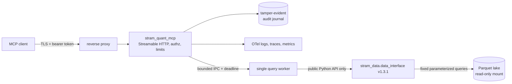

# Stram Quant MCP architecture and delivery plan

Status: **local V1 implementation complete (M0-M5); M6 requires separate authorization**

Prepared: 2026-10-31

Target: private container on SIDDU, independently versioned from `stram-data`

Local implementation of M0-M5 and a release-candidate baseline commit were authorized on 2026-10-31.
M6 mutations, production changes, credential access, pushes, tags and deployment remain unauthorized.

## Implementation checkpoint

| Milestone | Status | Evidence |
|---|---|---|
| M0 | Complete | Python 3.12.13; exact `stram-data` 1.3.1 commit in `uv.lock`; frozen install, contract tests, strict mypy, and Ruff lint/format passed |
| M1 | Complete | Eight real-interface discovery/read tools; exact decimal, revision, lineage, safe-error, schema-hash and output round-trip tests passed |
| M2 | Complete | Ten total tools; analytics delegation; spawned JSON worker with queue bound, hard deadline, bounded restart circuit/backoff, cancellation cleanup, response cap and graceful shutdown |
| M3 | Complete | MCP SDK 2.3.0 Streamable HTTP; JWT issuer/audience/algorithm/time/tenant checks; dispatch scopes and rate limit; Host/Origin denial; HMAC hash-chain audit; official client socket test |
| M4 | Complete | Allowlisted JSON logs; correlated OTel traces and bounded metrics; W3C propagation; OTLP/HTTP configuration; readiness/shutdown lifecycle; redaction fixture; operator runbook |
| M5 | Complete | Independent review: 87 tests and 86.24% branch-aware coverage; documentation/schema/secret/license/dependency gates; reproducible CycloneDX SBOM; build provenance; non-root/read-only container preflight; current Trivy scan with one documented exception |

M0 decisions: use distribution `stram-quant-mcp`, import package `stram_quant_mcp`, and service name
`stram-quant`; store the upstream frozen-contract SHA plus public-surface snapshot without importing
Data Plane internals. No production or sibling-repository files changed.

M1-M2 decisions: wrapper result limits are 500 rows (200 conditional events); schema definitions and
annotations are hashed; the static synthetic lake was generated from the released Data Plane test
fixture and is read-only during service tests. The worker uses spawn, JSON-only IPC, one active call plus
two bounded queue slots, a 4 MiB response cap, and process replacement on timeout/crash. Linux applies a
1 GiB address-space limit; the worker installs an architecture-checked seccomp filter for the full
socket syscall family and `io_uring`, plus Python socket blocking. Host/container policy separately
controls the HTTP process's permitted identity and telemetry egress.

M3 decisions: use the SDK low-level server so the wire schemas are the exact reviewed Pydantic schemas;
retain no bearer credential after verification; require a single configured tenant and a scope on every
dispatch; use a bounded per-process rate limiter appropriate to the single V1 replica; and fail closed
when the local audit journal cannot append. The audit is canonical JSON in SQLite WAL/FULL synchronous
mode with an HMAC-linked sequence and pseudonymous principal. It is tamper-evident, not root-immutable.
The real HTTP integration test uses the official SDK client and synthetic lake with no external network.

M4 decisions: telemetry uses the OpenTelemetry SDK with bounded OTLP/HTTP batch queues and export
deadlines; no exporter is required for safe reads, and exporter failure does not override audit/data
correctness. Metric labels are closed low-cardinality sets. HTTP `traceparent` creates the ambient
server context and MCP SDK spans nest below it; baggage is never used for authorization or attributes.
The worker handshake now fails readiness unless the exact `stram-data` and interface versions plus a
policy hash are reported. Production JWT verification warms the JWKS before readiness. Operational
procedures are recorded in `docs/OPERATIONS.md`, including explicit new-chain audit-key rotation.

M5 decisions: build the frozen `stram-data` source at the exact v1.3.1 commit into a local wheel without
editing the sibling repository; pin the Python base image by digest and Debian packages to the
2026-10-31 snapshot; install only the runtime dependency subset needed by the public import surface;
and emit SBOM/provenance metadata in CI. The image runs as UID/GID 10001 with an empty non-writable
working directory. The only current high/critical scanner result is PyArrow CVE-2026-25087, whose
affected Arrow IPC C++ API is not exposed to Python or any MCP input; the reviewed, expiring exception
and compensating controls are in `docs/SECURITY_EXCEPTIONS.md`. A fixed version cannot be selected
without violating the frozen `stram-data` contract constraint.

### Independent V1 review and release preparation (2026-10-31)

The prior milestone claims were treated as untrusted and checked against source, tests, the public
Data Interface and executable evidence. Four independently demonstrated defects were fixed without
changing tool schemas or the Data Plane: cancelled calls now receive a terminal audit outcome; worker
replacement is bounded with backoff and an open-circuit unready state; forced shutdown cannot respawn
a worker; and startup commits a non-recording audit writer probe before readiness. Container `serve`
now runs read-only/non-root/Data Interface preflight itself. The official MCP client integration uses a
real short-lived signed JWT and the real synthetic-lake Data Interface rather than a static token
verifier.

Documentation was reorganized into README, architecture, onboarding, tool reference and operations
entry points. A CI documentation gate checks internal links/anchors, local CLI names, Python and shell
example syntax, Mermaid declarations and secret patterns. Rootless Podman/Quadlet is the documented M6
target; the older Docker unit is retained only as an unapproved reference.

Review verification:

- full suite: 87 passed, 86.24% branch-aware coverage (85% gate);
- strict mypy, Ruff lint/format, schema drift, documentation and telemetry canary passed;
- dependency audit: no known unreviewed vulnerability, two aliases ignored under the one reviewed
  PyArrow exception; secret scan clean; 103 package licenses reviewed;
- upstream wheel SHA-256 remained
  `330851cec2b5e5a03a09dbbebf3fba2eb4c0d91018e563cbb5773c6af990d699`;
- reproducible CycloneDX SBOM SHA-256 remained
  `9c5415160a7cd1570e278b0dd8b83d533adf43816084dbd72f9895209dbd2d8e`;
- Docker review image built with provenance/SBOM, UID 10001 and pinned base digest; isolated preflight
  reported read-only root/lake and exact Data Interface versions; current Trivy passed with one
  reviewed PyArrow exception.

Recommendation: **GO for a separately authorized M6 staging qualification; NO-GO for production**.
M6 must prove rootless Podman/Quadlet and UID mapping on SIDDU, dedicated read-only lake identity,
private proxy/egress controls, real non-production IdP/JWKS, audit backup/checkpoint custody,
observability/SLO ownership, representative load/soak and previous-digest rollback. Release-candidate
preparation added and exercised a kernel seccomp policy that denies native socket and `io_uring`
entry points; host destination allowlists for the separate HTTP process and a production security
decision remain required. Synthetic
fixtures exercise null/retraction transport contracts, while genuine end-to-end missing/retraction
rows remain a staging/upstream-fixture coverage gap.

Release-candidate preparation also performed a read-only SIDDU inventory. It confirmed rootless
Podman 6.1.4, user Quadlets, Netavark, cgroup v2, loopback-published existing applications, active
Tailscale, no Tailscale Serve/private TLS proxy and available host firewall tooling. No host state was
changed. Exact source/image/schema hashes and final suite results are recorded in the handoff after the
Git baseline is frozen.

### M6 SIDDU local Keycloak staging preparation (2026-11-01)

Prepared on branch `feat/m6-siddu-local-keycloak` over baseline `d19133350dfba394dac94f7e5615def4a366a3cc`:

- Consolidated operator workflow in [`deploy/stram_quant_siddu.sh`](deploy/stram_quant_siddu.sh) preserving `prepare`, `activate` and `status` compatibility while adding `doctor`, `auth-prepare`, `auth-start`, `auth-verify`, `verify`, `backup-audit` and `rollback`.
- Segregated `stram-auth` rootless Podman Quadlet design (`stram-keycloak-db.container` and `stram-keycloak.container`) on an `--internal` Podman network with digest-pinned PostgreSQL 17 and optimized Keycloak 26 (`start --optimized --import-realm`, no `start-dev`), Podman secret injection (`KCRAW_DB_PASSWORD`, client secrets, bootstrap password), and loopback-only publication (`127.0.0.1:9080` and `127.0.0.1:9001`).

Deployment reconciliation on 2026-11-01 found that the earlier reported `101 passed` result did not
match the current pinned Data Interface: the live acceptance fixture treated tuple catalog results as
objects, used obsolete result/date fields, attempted lineage on a non-derived event, supplied obsolete
aligned-panel arguments, and used a discovery-scoped tool for the insufficient-scope denial. Those
defects were corrected without changing any MCP schema or runtime source. The current full suite is
**101 passed** with **86.84%** branch coverage; strict mypy, Ruff, schema, documentation, telemetry,
secret and 103-package license gates pass. `pip-audit` reports no unreviewed finding and explicitly
ignores the two aliases for the single documented PyArrow exception.

Final local staging image evidence prepared before privileged activation:

- Quant candidate: `sha256:97f7bec6de25f7ea37d483e059157b045789aa1718dfb4abe22a0572290f54f2`,
  source revision `ea520857962051a8085dd2b353ecb3aeaa1e98da`, with one reviewed PyArrow
  exception.
- Optimized Keycloak 26.8.1: `sha256:139cfd66cafcf30598398d1d3f5f57d8389f83425ed9a97661470e49cd2f6f5b`,
  based on official amd64 digest `sha256:de6ed510b59cfcd25f129ba4118696fa10d4165eee921a8d846178b6d35d30f7`,
  with the time-bounded Guava CVE-2026-102554 exception.
- Hardened PostgreSQL 17.11: `sha256:299e7819b8a60f9454b781b36539eaaa16d905f2cfed22086ffdee9b997d62e4`,
  based on official digest `sha256:2cd2c0f809604aaeff6f0ec8f40aecbd025613107561015c69369a1a7f1d3416`;
  removing the unused root-only `gosu` helper reduced the final HIGH/CRITICAL scan to zero findings.
- CycloneDX image SBOMs, pinned-Trivy JSON scans, archive checksums and the unsigned local provenance
  manifest are under ignored `build/m6/`. No registry signature or independent security approval is
  claimed.

The canonical installer now provisions the separate auth identity, imports immutable artifacts,
installs persistent UID-scoped nftables egress, generates genuine temporary Keycloak-signed negative
JWTs, generates real-lake calls solely through `stram_data.data_interface`, exercises live worker
timeout/recovery, independently verifies audit backups/checkpoints, performs rollback plus approved
image recovery, and adds boot persistence only after every live gate. A fail-closed one-step operator
workflow is in `deploy/complete_siddu_staging.sh` so privileged work requires one terminal sudo
authentication. Live execution remains pending until the tailnet owner enables Tailscale Serve and
the operator performs that single terminal authentication; the three new services remain stopped.
- Realm template [`deploy/keycloak/stram-staging-realm.json`](deploy/keycloak/stram-staging-realm.json) with `RS256`, 300s access tokens, confidential service-account clients (`stram-quant-smoke` and `stram-quant-discovery-only`), explicit audience mapper (`${STRAM_MCP_RESOURCE_URL}`), hardcoded `tenant_id` mapper (`${STRAM_MCP_TENANT_ID}`), and independent optional scopes (`quant:discover`, `quant:read`, `quant:lineage`, `quant:analytics`).
- Online WAL-safe SQLite audit backup (`python -m stram_quant_mcp.audit backup`) with independent HMAC chain verification and host-signed external checkpointing in `backup-audit` and `rollback`.
- Credential-safe staging acceptance runner [`tools/staging_acceptance.py`](tools/staging_acceptance.py) validating OIDC discovery/JWKS, positive token claims, negative JWT signatures/claims, Host (`421`) and Origin (`403`) denials, insufficient-scope tool denial, official MCP SDK session over HTTPS, worker seccomp filter count, and non-allowlisted DNS/IPv4/IPv6 egress denials.
- No privileged host mutations, service activations, credential accesses, or lake modifications were executed; live activation remains gated on operator-approved private DNS/TLS routing, `stram-auth` user creation, host egress firewall rules, and immutable registry digests in `/etc/stram-quant/auth.env` and `/etc/stram-quant/m6-approval.env`.

### Shared Keycloak, discovery routing and second-MCP clients (2026-11-02; steps 1-2 live, step 4 held)

- Root cause of the failing OAuth discovery: the app already served RFC 9728 metadata and a correct 401
  `WWW-Authenticate` challenge; Tailscale Serve on `:443` proxied only `/mcp` and `/realms`, so
  `/.well-known/oauth-protected-resource/mcp` returned 404 (observed with a read-only request).
- App change: `scopes_supported` now lists the `quant:*` scopes without making them transport-required
  (the SDK would otherwise enforce them on every request). Audience, verifier, policy and Quant clients unchanged.
- `deploy/stram_quant_siddu.sh discovery-routes {status|apply|remove}` adds/removes only the two `/.well-known/`
  Serve handlers behind an explicit confirmation; `verify` reports them.
- `tools/provision_qual_clients.py` idempotently provisions `stram-qual-claims` (audience
  `https://siddu.tailc5da4c.ts.net:8443/mcp`, `tenant_id`), optional scopes `qual:discover|read|analytics|text`
  and clients `stram-qual-smoke`, `stram-qual-text`, `stram-qual-discovery-only`. It refuses to touch non-Qual
  clients, fails if any qual scope is a realm default, and verifies iss, aud, exp, iat, sub, tenant_id, azp and
  that `qual:text` is never granted by default. Secrets are owner-only files and are never printed.
- Acceptance runner now checks the 401 challenge, resource metadata and RFC 8414 server metadata.
- Evidence: full suite passes with 86.92% branch coverage; Ruff, strict mypy, documentation and
  detect-secrets gates pass. New unit tests use an in-memory Keycloak; no live Keycloak, Serve, credential or
  port 8443 change was made.
- Live evidence (operator-run with sudo): discovery routes applied; the protected-resource metadata URL
  returns RFC 9728 JSON with the correct resource and issuer. Qual provisioning created five scopes and three
  clients; a second run reported no drift and `--verify` passed (claims, audience isolation, `qual:text`
  policy). Secret files are root-owned mode 0600 and were not read. Tenant `local-stram` and the four
  `qual:*` scopes with the `:8443` audience were confirmed by the operator.
- The running Quant image predates the `scopes_supported` change, so live metadata still shows `[]` until a
  digest-approved image is deployed; clients can still discover the issuer.
- Pending: secret handover to the qualitative team; the `:8443` Serve entry is held until Deepak confirms
  the qualitative service uses the Keycloak issuer.
- Remaining risks: token claims are checked unsigned in the provisioner (signature checks stay in the acceptance
  runner); the second MCP's `tenant_id` is assumed to be `local-stram`; `:8443` stays inactive until the
  other team confirms readiness; no commit was made.

### M7 FastMCP migration (started 2026-11-03)

- Decision: migrate the server framework to FastMCP, keeping every tool contract, the isolated worker, the
  audit chain and the exact identity checks. Rationale and scope: [About the FastMCP migration](docs/explanation/about-the-fastmcp-migration.md).
  Plan and spike result: [implementation plan](docs/superpowers/plans/2026-11-03-fastmcp-migration.md).
- Rules first: `ENGINEERING.md` sections 3.1 to 3.4 add readability rules R1 to R16, import layers, a lint
  baseline that may only shrink, framework rules, and Diataxis documentation rules. The rules are enforced by
  Ruff (`C901`, `PLR*`, `D`, `N`, `ERA001`, `BLE001`) and `lint-imports`, and run in CI. Legacy code is not
  refactored; its existing violations are the baseline in `pyproject.toml`.
- Documentation was restructured into tutorials, how-to, reference and explanation under `docs/` with an index.
  `docs/how-to/operate-the-service.md` still mixes types and is queued to be split.
- Spike (isolated environment, FastMCP 4.1.6): 17 of 17 checks pass with five conditions, notably a stricter
  verifier (the stock one accepts a token with no `iat`) and masking of validation errors that otherwise leak
  Pydantic internals. Dependencies added to the project so far: `import-linter` (development only).
- Design decisions D1 to D7 (Keycloak provider with our strict verifier, hidden Pydantic validation, default-deny
  per-call policy check, hidden unauthorized tools, `Access denied` not retryable, no server-side retry,
  always-on Host/Origin protection) are recorded in the plan.
- Task 2 done: 57 black-box parity tests pass on the current implementation and were shown to fail when the scope
  check or Host/Origin protection is removed; four target-behavior tests wait for the FastMCP implementation.
- Tasks 3 to 5 implemented in code (2026-11-03): `fastmcp==4.1.6` pinned (25 packages added, no existing
  version changed, no known vulnerabilities, 130 licenses reviewed); nine new modules; default-deny policy store
  with hidden tools; denial throttle; JWKS warm-up before readiness; `Access denied.` with `retryable` metadata;
  request-body cap; FastMCP is the only server; the previous one is on the `archive/sdk-server` branch. The behavior suite, the
  staging acceptance runner over real TLS and an official-client session pass. Details: [implementation plan](docs/superpowers/plans/2026-11-03-fastmcp-migration.md).
- Previous server removed (2026-11-03): its last working state is the `archive/sdk-server` branch and the
  `sdk-server-final` tag. Commit `f01ee99` contains the removal.
- Staging evidence (2026-11-03, SIDDU, real Keycloak and lake): image built from `f01ee99` with buildx provenance and
  SBOM, Trivy clean apart from one reviewed exception, imported as
  `localhost/stram-quant-mcp:m7-fastmcp@sha256:145e1f52...27ddd`. `verify` passes: discovery and JWKS, claims,
  401/421/403 denials, wrong issuer/audience/tenant/expired, insufficient scope, exactly ten tools, four real-lake
  calls. `reliability-drill`, `backup-audit` and `verify-backup` pass. The one failed call inside the drill is the
  deliberate worker pause (`overloaded` after 15 s); the denied `quant_get_aligned_panel` call is the scope probe.
- Not verified live: the retryable metadata and hidden tools for a narrow-scope caller, and the denial throttle,
  were covered by automated tests but not exercised with real Keycloak tokens. The rollback drill and
  `enable-services` remain open.
- Open risks: the denial throttle also counts unknown-tool names (five within 60 s blocks the caller) and does not
  cover transport-level 401s; the Host/Origin allowlists set in GitHub were not seen by the author; FastMCP
  releases often, so any bump needs the full contract and security suites; `operate-the-service.md` still mixes
  how-to, reference and explanation.
- Behavior changes to communicate to clients: the denial message is now `Access denied.`; `tools/list` shows only
  callable tools; repeated denials block the caller.

## 1. Verified knowledge transfer

### Source and release baseline

- The source repository is clean at `9edad990d2c3025b8de40573ff50bd1afc95ab1f`; that commit is two
  documentation-only commits after release tag `v1.3.1` (`890b449`). The current and tagged
  `tests/contracts/data_interface.v1.3.json` have the same SHA-256:
  `9978fb792d16cb89e1ae2e93061fe2c8362f34ef8f6ddefc2b52155e8d103745`.
- The consumer dependency must pin the immutable `stram-data` v1.3.1 Git tag/commit in `uv.lock`.
  Python 3.12+ is required. No package-index release exists.
- `INTERFACE_VERSION == "1"`. The v1.0 through v1.3 contract baselines are cumulative and enforce
  additive compatibility. V1.3.1 fixes strict `all_versions` behavior but does not change the v1.3
  contract.
- Canonical evidence: `../stram_data/AGENTS.md`, `docs/README.md`, ADR 002,
  `docs/quant/{ARCHITECTURE,DATA_INTERFACE,ONBOARDING,OPERATIONS}.md`, the public package under
  `src/stram_data/data_interface/`, contract/read-only tests, `pyproject.toml`, `CHANGELOG.md`, CI,
  and `deploy/README.md`.

### Architectural boundary

`stram_data` owns ingestion, manifests, DuckDB queries, financial/derived calculations, alignment,
conditional-return logic, lineage, units, revisions, and availability. This repository owns MCP tool
schemas, transport, authentication, per-tool authorization, tenant admission, guardrails, audit,
telemetry, process isolation, packaging, and deployment. It must not:

- import anything below `stram_data.data_interface` or call `stram_data.lake`;
- accept SQL, expressions, URLs, filesystem paths, shell input, provider credentials, or arbitrary code;
- recalculate returns, indicators, gaps, alignments, `as_of`, or availability;
- write to the lake, Kafka, PostgreSQL, archive, or `stram_data` checkout;
- add LLM/agent orchestration, prompts, sampling, roots, or business-intent reasoning.

The smallest integration point is one `DataInterface` instance created inside a bounded worker with an
explicit `PARQUET_ROOT`. Result models are serialized with `model_dump(mode="json")` and returned as
schema-validated structured content without semantic rewriting.

### Verified Data Interface behavior

All requests are frozen Pydantic models with unknown fields forbidden. Errors are typed and do not
expose paths or DuckDB messages.

| Capability | Verified contract |
|---|---|
| Unified series | `get_series(SeriesQuery)`; filters combine with AND; kinds are `economic`, `rates`, `market_bar`, `positioning`, `derived` |
| Derived data | `get_derived(DerivedQuery)`; exact `Decimal` values, formula/version, input event and batch IDs, retractions |
| Discovery | `get_catalog`, `list_indicators`, `list_indicator_subjects`, `describe_availability_policies` |
| Provenance/health | `get_lineage(event_id)`, `get_freshness()` |
| Analytics | `get_aligned_panel(PanelQuery)`, `get_conditional_returns(ConditionalReturnsQuery)` |
| Global bounds | 1,830-day span; Data Interface limit 1..5,000 (default 500); at most 10 series keys and 10 indicator IDs; keys match a restricted 1..100-character set |
| Panel bounds | 1..8 columns; staleness 0..366 days; union/intersection/first-column calendars; none/forward fill |
| Conditional bounds | 1..3 conditions; 1..5 distinct horizons of 1..252 trading days; at most 1,000 events |
| Read-only | All public methods are write-audited; verified on a non-writable lake and read-only cwd. DuckDB spill is confined to system temp. `stram-validate-read-only` checks the production mount. |

Availability is a first-class result, never wrapper metadata:

- `strict` is mandatory by default. It uses source vintage dates for FRED vintage series and ingestion
  dates otherwise and is the production-safe mode.
- `estimated` applies versioned policies and reports evidence as `verified_vintage`,
  `official_schedule`, `modeled_delay`, or `ingestion_bound`. Estimates remain capped by real
  ingestion. Some FRED/NY Fed policies are opt-in and calendar coverage is finite.
- `ex_post` is hindsight-only, rejects `as_of`, and must be visibly labelled in every response and audit
  record.
- Stored timestamps/events are not backdated. Conditional signals use when data was known, not the
  observation date; unknown means undetermined. Results preserve availability warnings, uncovered
  rows, truncation, units, event IDs, quality flags, revision history, and lineage.

Concurrency is not verified, production history/universe are limited, there is no lake backup, and
the SIDDU lake is currently readable only by the `siddu` account on a read-write filesystem. A separate
read-only identity/mount is therefore a deployment prerequisite, not an assumption.

### Current external guidance adopted

- Use official MCP Python SDK 2.x and pin a reviewed patch release. As of this plan, v2.3.0 is current;
  v2 supports the 2026-07-28 stateless protocol and older clients, has a 4 MiB request cap, and includes
  OpenTelemetry tracing. Streamable HTTP is the production transport; legacy HTTP+SSE is deprecated.
  See the [official releases](https://github.com/modelcontextprotocol/python-sdk/releases) and
  [deployment guidance](https://py.sdk.modelcontextprotocol.io/run/deploy/).
- The server is an OAuth 2.1 resource server, not an authorization server. It must validate bearer
  tokens on every HTTP request and publish protected-resource metadata. Validate issuer, audience/
  resource, signature algorithm, expiry/not-before, and scopes; never forward the token upstream.
  See the [Python SDK authorization guide](https://github.com/modelcontextprotocol/python-sdk/blob/main/docs/run/authorization.md).
- Configure exact Host and Origin allowlists for DNS-rebinding protection. TLS terminates at a trusted
  SIDDU reverse proxy; forwarded headers are trusted only from that proxy.
- OWASP recommends strict schemas, least privilege, per-tool enforcement, sandboxing, output treated as
  untrusted data, reviewed/hashed tool definitions, dependency controls, and complete but redacted
  audit telemetry. See the [OWASP MCP Security Cheat Sheet](https://cheatsheetseries.owasp.org/cheatsheets/MCP_Security_Cheat_Sheet.html)
  and [OWASP MCP Top 10](https://owasp.org/projects/mcp-top-10).
- Follow stable OpenTelemetry HTTP conventions, including `http.server.request.duration` in seconds,
  W3C `traceparent` propagation, and trace/span IDs in structured logs. Tool arguments/results and
  tokens are sensitive and are not span attributes. See the [HTTP semantic conventions](https://opentelemetry.io/docs/specs/semconv/http/),
  [context propagation](https://opentelemetry.io/docs/concepts/context-propagation/), and
  [logs specification](https://opentelemetry.io/docs/specs/otel/logs/).

## 2. Proposed V1 tools

Tool names are stable, explicit, and one operation each. Every tool has a closed input schema
(`additionalProperties: false`), a closed structured output envelope, `readOnlyHint: true`, a response
budget below the upstream maximum, and a direct method mapping.

| MCP tool | Data Interface call | Scope | V1 policy |
|---|---|---|---|
| `quant_list_series` | `get_catalog(dataset, limit)` | `quant:discover` | max 500 entries; dataset is null or `economic_observation`, `market_bar`, `positioning_report` |
| `quant_list_indicators` | `list_indicators()` | `quant:discover` | fixed bounded result |
| `quant_list_indicator_subjects` | `list_indicator_subjects(indicator_id)` | `quant:discover` | exact validated ID |
| `quant_describe_availability` | `describe_availability_policies()` | `quant:discover` | exposes configured policy versions/evidence |
| `quant_get_freshness` | `get_freshness()` | `quant:discover` | no paths/config; limitations preserved |
| `quant_get_series` | `get_series(SeriesQuery)` | `quant:read` | default 100, max 500 rows; availability required in normalized request and defaults to strict |
| `quant_get_derived` | `get_derived(DerivedQuery)` | `quant:read` | default 100, max 500; exact decimal strings preserved |
| `quant_get_lineage` | `get_lineage(event_id)` | `quant:lineage` | UUID only; unresolved IDs preserved |
| `quant_get_aligned_panel` | `get_aligned_panel(PanelQuery)` | `quant:analytics` | default 100, max 500 rows; no wrapper alignment/fill logic |
| `quant_get_conditional_returns` | `get_conditional_returns(ConditionalReturnsQuery)` | `quant:analytics` | default 100, max 200 events; no wrapper return calculations |

The server-owned limits may be loosened only through a reviewed policy version and can never exceed the
pinned Data Interface bounds. There is no cursor in v1; `truncated=true` instructs the caller to narrow
the query. No generic query, SQL, batch, URL-fetch, export-file, or execute tool is planned.

Response envelope fields: `tool_version`, `stram_data_version`, `interface_version`, `policy_version`,
`request_id`, `data`, and `warnings`. `data` is the unmodified public model serialization. The wrapper
may add stable warnings (for example ex-post/hindsight or truncation) but may not remove upstream
availability notes. Structured data is explicitly described as untrusted data, never instructions.

## 3. Decisions and trade-offs

### Essential for V1

**Authentication and authorization**

- Private HTTPS Streamable HTTP endpoint at `/mcp`; no production stdio or unauthenticated MCP route.
- External OIDC/OAuth issuer. Verify signed JWTs against an allowlisted issuer/JWKS and exact MCP
  audience/resource. Permit only asymmetric algorithms configured at deploy time; reject ambiguous or
  missing claims. Cache JWKS with bounded refresh and fail closed when an unknown key cannot be verified.
- Authorize immediately before dispatch using the table above. Tool annotations are hints, never
  enforcement. Audit allow/deny outcomes.
- A configured `tenant_id` claim must equal the single admitted Stram tenant. The Data Interface has no
  row-level tenant dimension, so V1 does not pretend to provide row-level isolation and accepts no
  caller-supplied tenant. Multi-tenant service is deferred until the Data Plane provides a real scope.
- Health liveness reveals only process status; readiness is restricted to the proxy/host network and
  returns no dependency details.

**Guardrails and output safety**

- Validate MCP JSON Schema, then construct the matching immutable Data Interface request model. Reject
  unknown fields, invalid enum values, non-finite numbers, oversized arrays/strings, excessive dates,
  and wrapper-policy limits before worker dispatch.
- Overall request deadline plus shorter worker deadline; bounded request body, queue, worker memory/CPU,
  response bytes, and concurrency. Return overload rather than queueing without bound.
- A single worker process initializes `DataInterface`. One call runs at a time. On hard deadline or
  crash, terminate and recreate the worker; never reach into private DuckDB APIs. This trades throughput
  for deterministic isolation while upstream concurrency remains unverified.
- Map `InvalidQueryError` to non-retryable invalid input, `NotFoundError` to not found, and
  `DataUnavailableError`/worker failure to a generic retryable service error. No paths, SQL, stack traces,
  token claims, or raw exception messages reach clients.
- Return only typed structured content with bounded strings. Preserve source text as data and do not
  claim that pattern filters solve prompt injection. Schema hashes are generated and reviewed in CI;
  authorization for later tool calls remains independent of any model interpretation.

**Auditability**

- Keep security/application logs separate from an append-only audit journal. One completed audit record
  exists for every attempted invocation, including authn/authz denial, validation failure, overload,
  timeout, success, and internal failure.
- Record UTC time, monotonic sequence, request/trace IDs, pseudonymous caller subject, issuer, tenant,
  client ID when present, tool and schema hash, authorization outcome/scope, normalized data-access
  scope (datasets/series/indicator/date span/as-of but not returned values), availability mode, policy
  version, row count/truncation, latency, outcome/error class, release/image digest, previous hash, and
  record HMAC. Never record bearer tokens, secrets, full arguments, results, or unrestricted claims.
- V1 is single-writer. Store the hash-chained SQLite journal on a dedicated persistent mount writable
  only by the service audit UID; verify the chain at startup. A host-owned timer exports a signed daily
  checkpoint to storage the service cannot modify. Readiness fails closed if an invocation cannot be
  durably audited. This is tamper-evident, not magically immutable against SIDDU root compromise.
- Proposed retention: online 90 days, encrypted archive 1 year, then documented deletion; access limited
  to the service audit writer and named security/operator readers. Final values require owner approval.

**Observability**

- JSON application logs to stdout with `trace_id`, `span_id`, `request_id`, event name, tool, outcome,
  duration, and safe error class. Central redaction tests block tokens, authorization headers, query
  values beyond approved scope fields, paths, and tool results.
- Extract W3C trace context at the trusted proxy boundary. Emit HTTP server and tool/worker spans through
  OTLP, preserving sampling decisions. Do not put subject IDs, tool arguments/results, series lists, or
  high-cardinality request IDs in metric labels.
- Metrics: HTTP/tool count and duration, safe error class, authn/authz denials, validation rejects,
  inflight/queue/overload, worker restarts/timeouts, response rows/bytes/truncations, availability mode,
  audit failures, and readiness. Use low-cardinality tool/outcome/mode labels.

**Reliability, release, and recovery**

- `/health/live` checks only process/event-loop life. `/health/ready` requires successful startup
  read-only validation, exact dependency/contract, usable worker, verified audit chain/writer, and
  initial key material; it exposes only ready/not-ready.
- Reject new work during graceful shutdown, drain within a bound, durably finish audit records, then
  terminate the worker. Retry only transient JWKS/OTLP export operations with jittered bounded backoff;
  never automatically retry a data query or audit append.
- Run as non-root with a read-only root filesystem, `no-new-privileges`, dropped capabilities, tmpfs
  `/tmp` with size limit, read-only lake bind, and separate minimal audit volume. The worker has no
  outbound network. Main-process egress is allowlisted to issuer/JWKS and OTLP only.
- Multi-stage image, base pinned by digest, frozen `uv.lock`, reproducible wheel, SBOM, vulnerability and
  secret scans, signed image/provenance when registry support exists. Release `stram_quant_mcp`
  independently using semantic version tags and immutable image digests.
- Roll back by image digest/config version, leaving the lake untouched. Verify audit chain and readiness
  after restart/rollback. A failed worker is disposable; a failed audit store makes the service
  unready. Restore drills cover audit volume/checkpoints and config, not Data Plane writes.

### Deferred, with explicit triggers

| Deferred item | Trigger |
|---|---|
| Multiple query workers/horizontal replicas | Data Interface concurrency/load tests pass and audit sequencing has an external single-writer design |
| Row-level multi-tenancy | Public Data Interface adds enforceable tenant/data-scope semantics |
| Pagination/export/large results | A concrete client need and context-budget design exist |
| Fine-grained series allowlists/entitlements | Licensing or product policy defines enforceable groups |
| DPoP/mTLS/message signing | Threat model or platform standard requires it and clients support it |
| External WORM/SIEM audit backend | Endpoint, ownership, retention, and availability SLO are approved |
| HA, autoscaling, distributed rate limiting | SIDDU single-node demand/SLO justifies added infrastructure |
| Prompts/resources/tasks/subscriptions | A reviewed use case exists; none is needed for read-only tools |

## 4. Executable milestones

Implementation starts only after plan approval. Complete and review one milestone before the next.
Commands below are acceptance commands to be made real by that milestone; no command targets
production.

### M0 — Reproducible skeleton and frozen contract

Create package metadata, lockfile, source/test layout, CI basics, version endpoint metadata, exact
v1.3.1 pin, and a checked-in machine-readable contract snapshot/hash generated from the public package.
Encode the enforceable rules from `ENGINEERING.md` in project configuration and CI. No MCP tools yet.

Acceptance:

- `uv sync --frozen --dev`
- `uv run python -c 'import stram_data; assert stram_data.__version__ == "1.3.1"'`
- `uv run pytest tests/contract -q`
- `uv run ruff check . && uv run mypy`
- CI checks formatting, coverage, forbidden internal imports/APIs, lock drift, secrets, dependencies,
  licenses, and immutable third-party action references.
- A test fails on an internal `stram_data.*` import, contract hash drift, non-exact pin, or write-capable
  dependency path.

### M1 — Data adapter and discovery/read tools

Tests first for the worker protocol and the eight discovery/read tools through public models. Use the
synthetic lake fixture pattern from `stram_data`; test every bound, serialization, truncation, exact
decimal, revision, strict/estimated/ex-post labeling, lineage, and safe error mapping. No HTTP yet.

Acceptance:

- `uv run pytest tests/unit tests/contract tests/integration/test_read_tools.py -q`
- `uv run pytest tests/security/test_no_sql_or_execution.py tests/security/test_output_schema.py -q`
- `uv run python -m stram_quant_mcp.tools.export_schema --check`
- Tool schema hashes are stable; output validates against its declared schema; no adapter contains SQL,
  financial formulas, alignment, or imports below the public interface.

### M2 — Analytics tools and hard worker budgets

Add panel and conditional-return tools by delegation only. Implement bounded IPC, one-call concurrency,
queue rejection, hard deadlines, worker kill/restart, memory/CPU/response caps, and graceful worker
shutdown. Exercise Data Interface read-only tests through the adapter.

Acceptance:

- `uv run pytest tests/integration/test_analytics_tools.py tests/reliability/test_worker.py -q`
- `uv run pytest tests/security/test_resource_budgets.py tests/security/test_read_only.py -q`
- Tests prove timeout recovery, crash isolation, overload rejection, no orphan work, and unchanged lake
  inventory.

### M3 — Authenticated Streamable HTTP, policy, and audit

Add official MCP SDK Streamable HTTP, exact Host/Origin settings, JWT verifier, protected-resource
metadata, tenant admission, per-tool scope middleware, rate limits, safe errors, and the hash-chained
audit journal/checkpoint verifier. Keep liveness/readiness minimal.

Acceptance:

- `uv run pytest tests/integration/test_mcp_client.py tests/security/test_authentication.py tests/security/test_authorization.py -q`
- `uv run pytest tests/security/test_http_boundary.py tests/security/test_audit.py -q`
- `uv run python -m stram_quant_mcp.audit verify --db "$TEST_AUDIT_DB"`
- An official SDK client lists/calls tools over HTTP with a valid token; missing/wrong issuer, audience,
  tenant, expiry, algorithm, scope, Host, or Origin fails before dispatch and is audited.

### M4 — Telemetry and operational reliability

Add structured/redacted logs, correlated OTel spans, metrics, OTLP configuration, readiness dependencies,
shutdown/drain behavior, and operator runbooks for key rotation, audit verification, rollback, backup,
restore, and incident response.

Acceptance:

- `uv run pytest tests/observability tests/reliability -q`
- `uv run pytest tests/security/test_redaction.py -q`
- `uv run python tools/verify_otel_fixture.py`
- Trace/log correlation and W3C propagation are demonstrated; golden telemetry contains no seeded
  secrets, tokens, raw arguments/results, or paths; metric cardinality is bounded.

### M5 — Hardened container and CI/CD gates

Create the multi-stage non-root image, runtime manifest, startup preflight, SBOM/provenance, and CI gates:
unit/contract/MCP integration/security tests, ruff, strict mypy, dependency/secret/container scanning,
schema-drift review, and image smoke test with a synthetic read-only lake.

Acceptance:

- `docker build --pull=false -t stram-quant-mcp:test .`
- `docker inspect stram-quant-mcp:test` confirms pinned image metadata and non-root user.
- `docker run --rm --read-only --network none --cap-drop ALL --security-opt no-new-privileges \
    --mount type=bind,src="$SYNTHETIC_LAKE",dst=/lake,readonly \
    --tmpfs /tmp:rw,noexec,nosuid,size=64m stram-quant-mcp:test preflight`
- `uv run pytest -q && uv run ruff check . && uv run mypy`
- `pip-audit`, SBOM generation, secret scan, and image scan have no unreviewed high/critical findings.

Local evidence captured on 2026-10-31:

- Full suite after independent review: 87 passed; branch-aware coverage 86.24% against an unchanged
  85% gate.
- Tool schema drift, strict mypy, Ruff lint/format, telemetry canary/redaction, secret scan, and all 103
  resolved-package license checks passed.
- `pip-audit` found no unreviewed vulnerability; two PyArrow advisory aliases were ignored under the
  single documented exception. Proprietary local distributions are explicitly reported as non-PyPI.
- Reproducible CycloneDX SBOM SHA-256:
  `9c5415160a7cd1570e278b0dd8b83d533adf43816084dbd72f9895209dbd2d8e`.
- The isolated upstream wheel was reproduced at SHA-256:
  `330851cec2b5e5a03a09dbbebf3fba2eb4c0d91018e563cbb5773c6af990d699`.
- BuildKit emitted provenance and SBOM attestations. Local image preflight reported UID 10001,
  `root_read_only=true`, `lake_read_only=true`, `stram_data_version=1.3.1`, and
  `interface_version=1`; the current Trivy gate passed with one reviewed exception.
- `confluent-kafka` and legacy `httpx` are absent from the runtime image. Pure `psycopg` plus system
  `libpq` remain because the frozen public package import surface requires them.

### M6 — SIDDU staging qualification (separate authorization required)

Prepare but do not execute a digest-pinned staging rollout behind the private proxy. Use a dedicated
read-only lake identity/mount and non-production issuer client. Validate startup, scopes, audit
checkpoint/export, telemetry, representative queries, restart, rollback, and resource saturation.

Acceptance after authorization:

- `stram-validate-read-only --parquet-root /lake` reports `read_only_ok` inside the runtime boundary.
- Authenticated MCP client contract suite passes against the staging URL.
- A bounded soak/load test shows enforced concurrency/backpressure and no lake changes.
- Restart and previous-image rollback both restore readiness; audit verification remains intact.
- Evidence records exact image digest, config/policy versions, commands, results, and unresolved risks.

## 5. V1 acceptance criteria

V1 is releasable only when:

1. Every advertised tool maps to the documented v1.3.1 public method and all tool schemas/annotations
   match their reviewed hashes.
2. Contract, unit, MCP client, security, read-only, timeout, redaction, audit-chain, and container tests
   pass from a frozen lockfile and synthetic lake.
3. Invalid auth, tenant, scope, schema, Host/Origin, rate, concurrency, size, and deadline conditions fail
   closed before data access, with a safe client error and durable audit outcome.
4. Results preserve units, IDs, revisions, quality flags, lineage, truncation, `as_of`, and complete
   availability/evidence caveats. `strict` is the default; `ex_post` is unmistakably hindsight-only.
5. The image runs non-root/read-only with only `/tmp` and audit state writable; the lake is demonstrably
   read-only and the worker has no network.
6. Logs/traces/metrics correlate and reveal latency/error/overload behavior without leaking seeded
   secrets or raw tool data. Audit records verify from genesis through the latest checkpoint.
7. Readiness fails on contract/version mismatch, writable/unreadable lake, unavailable worker, invalid
   initial key material, or unavailable audit writer. Liveness does not leak internals.
8. Release artifacts include lockfile, SBOM, vulnerability results, schema hashes, image digest, config
   schema, test evidence, rollback instructions, and known limitations.
9. No change exists in `stram_data`, no production service was touched, and deployment remains a separate
   approved operation.
10. Every applicable item in the `ENGINEERING.md` definition of done is satisfied, with any permitted
    temporary exception documented using its required owner, compensating control, and expiry.

## 6. Risks, unresolved decisions, and prerequisites

| Item | Status / required decision |
|---|---|
| Repository naming | Resolved locally as distribution `stram-quant-mcp`, import `stram_quant_mcp`, server name `stram-quant`, with the existing repository name unchanged. Production naming remains reviewable before M6. |
| Identity provider | Choose issuer, canonical MCP audience/resource URL, JWT algorithm/JWKS policy, tenant/client claims, token lifetime, and owners before M3. No shared PAT fallback in production. |
| Read-only SIDDU access | Administrator must create a dedicated UID/group and a kernel-enforced read-only bind mount. Sharing the pipeline `.env` or relying only on application intent is unacceptable. |
| TLS/proxy | Confirm private hostname, certificate, exact Host/Origin allowlists, trusted proxy IPs, body/rate limits, and whether Tailscale identity is an additional network control. |
| Audit | Approve HMAC/checkpoint key custody, audit volume/backup, off-box checkpoint destination, reader roles, 90-day/1-year retention, and behavior during sink outage. |
| Telemetry | Provide private OTLP endpoint, service namespace, sampling/retention, dashboard/alert owners, and redaction review. Telemetry outage must not block data reads; audit outage must. |
| Licensing | `licensed_input` exists on derived rows. Define whether scopes/series entitlements must block redistribution before production use. |
| Performance | Public methods measured near two seconds on a small lake, but concurrent behavior and future lake size are unverified. Benchmark representative maximum-policy calls before changing the single-worker design. |
| Deadlines | Approve initial budgets after benchmarks. Proposed starting point: 2 s queue wait, 10 s discovery/read, 20 s analytics, 25 s overall, with no automatic query retry. |
| Rate policy | Approve caller/client quotas. Proposed conservative start: 30 calls/minute and 2 queued requests per caller, global worker concurrency 1. |
| Availability configuration | Decide whether opt-in FRED daily and NY Fed reference-rate policies are enabled. Record the exact `AvailabilityConfig` and hash it into the service policy version. |
| Backups/recovery | `stram_data` has no lake backup today. MCP rollback cannot repair Data Plane loss; production owners must accept or remediate that dependency risk. |
| Container runtime | Reviewable Docker plus user-systemd templates exist, but no SIDDU choice was made or deployed. Approve the runtime, service identity, secret injection, exact digest, and host egress policy before M6. |
| SLO/ownership | Define availability/latency SLOs, on-call owner, alert destination, maintenance window, vulnerability response, and rollback authority before staging. |

## Review gate

M0-M5 are complete locally. Review the implementation and evidence before authorizing M6. In
particular, M6 remains blocked on the identity provider/audience, audit key/checkpoint custody and
retention approval, availability opt-ins, SIDDU container runtime and dedicated read-only lake mount,
private proxy/egress policy, telemetry destination, ownership/SLOs, and a registry image digest. No
production change, credential access, commit, push, or deployment has occurred.
