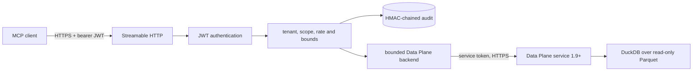

# Stram Quant MCP

Stram Quant MCP is the independently deployed, read-only MCP Tool Plane for Stram quantitative
data. Eleven typed tools expose the Stram Data Plane service (Data Interface v1, service 1.9 or later)
over authenticated Streamable HTTP. This repository owns transport, identity, authorization, bounds,
failure classification, audit and telemetry. It does not own SQL, financial calculations, ingestion, lake schemas or AI
orchestration.

Status on 2026-11-03: the server runs on FastMCP (milestone M7); the previous server is kept on the
`archive/sdk-server` branch. Status on 2026-10-31: M0-M5 are locally implemented and independently reviewed. Local tests and
synthetic-lake integration pass. M6 SIDDU staging is **not deployed or production-verified** and still
requires separate authorization and production decisions recorded in [PLANS.md](PLANS.md).

## Architecture in five minutes



Every call is authenticated and authorized before the Data Plane is contacted. The backend sends only
validated arguments, using this service's own short-lived token; no end-user token or claim leaves
the container. This service has no lake mount or query engine. Every failure says why it failed and
whether retrying can help. Terminal
success, denial and failure outcomes are appended to the audit chain; an audit append failure fails
the call closed. See [Architecture](docs/explanation/architecture.md) for the complete lifecycle and boundaries.

## Quick start

Supported toolchain: CPython 3.12 through 3.14 and `uv`. The lock pins the exact `stram-data` source
commit for release 1.9.0, used for its typed models only. Private repository access is needed only when the dependency is not already
available in the local cache.

```bash
uv sync --frozen --dev
uv run python -c 'import stram_data; assert stram_data.__version__ == "1.9.0"'
uv run pytest tests/integration/test_mcp_client.py -q
```

The integration test starts the real server on loopback, signs a short-lived JWT, connects with the
official MCP SDK client, discovers all eleven tools and calls the real Data Plane HTTP service, run in-process
over `tests/fixtures/lake`. It does not use production credentials or mocked quantitative responses.

Run the complete local gate:

```bash
uv run pytest --cov --cov-report=term-missing
uv run mypy
uv run ruff check .
uv run ruff format --check .
uv run python -m stram_quant_mcp.tools.export_schema --check
uv run python tools/check_docs.py
```

Container startup is stricter than local tests: the `serve` entrypoint runs preflight and refuses root
execution, a writable root filesystem, a writable lake, or dependency/interface drift.

## Documentation

Use the entry point that matches the job:

| Need | Document |
|---|---|
| Find any page by what you want to do | [Documentation index](docs/README.md) |
| Add a tool | [How to add a tool](docs/how-to/add-a-tool.md) |
| Understand boundaries and failure behavior | [Architecture](docs/explanation/architecture.md) |
| Install, test and connect a client | [Onboarding](docs/how-to/set-up-and-connect-a-client.md) |
| Look up tool schemas, scopes and errors | [Tool reference](docs/reference/tools.md) |
| Build, stage, monitor, recover or roll back | [Operations](docs/how-to/operate-the-service.md) |
| Review SIDDU prerequisites and templates | [Deployment](deploy/README.md) |
| Read the consolidated STRAM HQ M6 handoff | [STRAM HQ handoff](docs/STRAM_HQ_HANDOFF.md) |
| See milestone evidence and unresolved decisions | [Plans](PLANS.md) |
| Apply normative engineering rules | [Engineering standards](ENGINEERING.md) |
| Review the PyArrow exception | [Security exceptions](docs/reference/security-exceptions.md) |
| Read release-candidate notes | [Changelog](CHANGELOG.md) |

Do not deploy, access production secrets, change SIDDU, tag or push without separate authorization.
