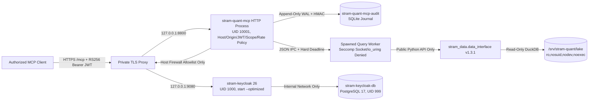

# STRAM HQ Handoff: Stram Quant MCP — SIDDU M6 Private Staging

> **Historical record (2026-11-01).** It describes the former design: `stram-data` 1.3.1 in-process,
> a spawned seccomp worker and a read-only lake mount. The service now calls the Data Plane over HTTP
> and has no lake mount. For the current design and procedure see
> [the HTTP gateway runbook](how-to/deploy-the-http-gateway.md) and
> [Architecture](explanation/architecture.md).

**Prepared:** 2026-11-01  
**Host:** `SIDDU` (EndeavourOS Linux, kernel 7.2.11-arch1-1, Rootless Podman 6.1.4, Netavark/pasta, cgroup v2)  
**Repository / Branch:** `/home/siddu/Apps/stram/stram_quant_mcp` (`feat/m6-siddu-local-keycloak`, reviewed runtime source `ea520857962051a8085dd2b353ecb3aeaa1e98da`)
**Pinned Data Plane:** `stram-data` `1.3.1` (`890b44911b56d0f165cfa7962032d00292b4e10e`), wheel SHA-256 `330851cec2b5e5a03a09dbbebf3fba2eb4c0d91018e563cbb5773c6af990d699`  
**Stage Status:** Code, immutable local images, scans/SBOMs, Quadlet templates, local Keycloak realm,
online WAL audit backup/checkpointing and HTTPS real-lake acceptance tests are **PREPARED & VERIFIED**
(`101/101` tests, 86.84% branch coverage). Live activation is **BLOCKED** on tailnet-owner Tailscale
Serve enablement and one operator-terminal `sudo` authentication. `stram-auth` and all three new
services remain absent/stopped; no live staging acceptance, backup, rollback or persistence claim is
made yet.

---

## 1. Infrastructure

### SIDDU Operating System & Deployment Model
- **OS & Runtime:** EndeavourOS Linux on `SIDDU` using rootless Podman 6.1.4 and systemd user Quadlets (`~/.config/containers/systemd/`).
- **Network Isolation Model:** All container listeners bind strictly to host loopback (`127.0.0.1`). No service binds to `0.0.0.0` on the host or opens a public internet port.
- **Tailscale & Private HTTPS Topology:**
  - Verified tailnet node: `siddu.tailc5da4c.ts.net` (`100.117.151.7`,
    `fd7a:115c:a1e0::d801:97d2`), Tailscale 1.104.4 with MagicDNS enabled.
  - Tailscale Serve is not yet enabled; no Serve configuration or certificate domain currently exists.
  - Approved private URLs (configured in `/etc/stram-quant/auth.env`):
    - **Quant MCP Resource / Audience (`STRAM_MCP_RESOURCE_URL`):** `https://<approved-private-quant-host>/mcp`
    - **Keycloak Public Issuer (`STRAM_MCP_ISSUER_URL`):** `https://<approved-private-auth-host>/realms/stram-staging`
    - **Keycloak OIDC Discovery:** `https://<approved-private-auth-host>/realms/stram-staging/.well-known/openid-configuration`
    - **Keycloak JWKS (`STRAM_MCP_JWKS_URL`):** `https://<approved-private-auth-host>/realms/stram-staging/protocol/openid-connect/certs`
    - **Keycloak Admin (`KEYCLOAK_ADMIN_URL`):** `https://<approved-private-auth-admin-host>` (blocked on the public reverse proxy).

### Linux Service Accounts & Permissions
| Account | UID / GID | SubUID / SubGID | Linger | Purpose & Boundaries |
|---|---|---|---|---|
| `stram-quant` | `1002:1003` (`/usr/bin/nologin`) | `231072:65536` | Enabled | Runs `stram-quant-mcp`. Read-only access to `/srv/stram-quant/lake`. Owns Podman volume `stram-quant-mcp-audit` and secret `stram-quant-audit-key`. No membership in Data Plane, Docker, Kafka, or PostgreSQL groups. |
| `stram-auth` | **Pending privileged creation** | Planned `296608:65536` | Pending | Will run `stram-keycloak-db` and `stram-keycloak` on internal network `stram-auth-private`; the installer blocks it from traversing `/srv/stram-quant`. |

No Quant-repository GitHub Actions runner was observed or enabled. Existing runners for other Stram
repositories were not modified.

### Filesystem Layout, Mounts & Protected Paths
| Path | Owner / Mode | Purpose |
|---|---|---|
| `/home/siddu/Apps/stram/data-lake/parquet` | `siddu:siddu` | Canonical Stock Parquet lake (797+ Parquet files; writable only by Data Plane ingestion). |
| `/srv/stram-quant/lake` | `root:root` (`ro,nosuid,nodev,noexec`) | Systemd bind mount (`srv-stram\x2dquant-lake.mount`) exposing read-only lake view to `stram-quant`. |
| `/etc/stram-quant/auth.env` | `root:root` `0600` | Non-secret Keycloak/MCP URLs, realm, tenant, ports, and immutable `@sha256` image digests. |
| `/etc/stram-quant/m6-approval.env` | `root:root` `0600` | Operator evidence gates (`M6_STAGING_AUTHORIZED`, `APPROVED_IMAGE_REF`, `ROLLBACK_IMAGE_REF`, etc.). |
| `/etc/stram-quant/secrets/` | `root:root` `0700` (files `0400`) | `keycloak-db-password`, `keycloak-bootstrap-password`, `keycloak-smoke-client-secret`, `keycloak-discovery-client-secret`, `checkpoint-signing-key`. |
| `/etc/stram-quant/staging-calls.json` | `root:root` `0600` | Representative Stock lake tool calls (`discovery`, `read`, `lineage`, `analytics`) for `verify`. |
| `/etc/stram-quant/negative-tokens/` | `root:root` `0700` | Temporary realm-signed negative test JWTs (`wrong-issuer.jwt`, `wrong-audience.jwt`, `wrong-tenant.jwt`, `expired.jwt`). |
| `/home/stram-quant/.config/stram-quant-mcp/service.env` | `stram-quant:stram-quant` `0600` | Non-secret MCP runtime configuration (`STRAM_MCP_*`). |
| `/home/stram-quant/.config/containers/systemd/stram-quant-mcp.container` | `stram-quant:stram-quant` `0600` | Rootless Quadlet unit for Quant MCP. |
| `/home/stram-auth/.config/stram-auth/import/stram-staging-realm.json` | `stram-auth:stram-auth` `0600` | Staged Keycloak realm import file. |
| `/home/stram-auth/.config/containers/systemd/stram-keycloak*.container` | `stram-auth:stram-auth` `0600` | Rootless Quadlet units for Keycloak PostgreSQL and Keycloak server. |
| `/var/lib/stram-quant/audit-backups/` | `root:root` `0400` artifacts | WAL-consistent SQLite audit backups (`audit-<UTC>.sqlite3`) and HMAC-signed checkpoints (`audit-<UTC>.checkpoint.json`). |

---

## 2. Services

| Service / Unit | Identity | Container UID/GID | Loopback Port | Network | Image Requirement | Status |
|---|---|---|---|---|---|---|
| `stram-keycloak-db.service` | `stram-auth` | `999:999` (`keep-id`) | None (internal alias `stram-keycloak-db:5432`) | `stram-auth-private` (`--internal`) | PostgreSQL 17.11 hardened digest below | Not installed / not running |
| `stram-keycloak.service` | `stram-auth` | `1000:0` (`keep-id:uid=1000,gid=1000`) | `127.0.0.1:9080->8080`, `127.0.0.1:9001->9000` | `stram-auth-private` (`--internal`) | Keycloak 26.8.1 optimized digest below | Not installed / not running |
| `stram-quant-mcp.service` | `stram-quant` | `10001:10001` (`keep-id:uid=10001,gid=10001`) | `127.0.0.1:8800->8000` | `stram-quant-private` + host nftables allowlist | Quant candidate digest below | Not installed / not running |

### Existing SIDDU Services (Verified Unchanged)
- `stram-api` (`127.0.0.1:8000`), `stram-ui` (`127.0.0.1:3000`), PostgreSQL
  (`127.0.0.1:5432`), Kafka (`127.0.0.1:19092`), Stock ingestion and News ingestion were active
  during the 2026-11-01 inventory and remain unmodified.

### Operational Commands
All lifecycle operations use the single idempotent entrypoint [`deploy/stram_quant_siddu.sh`](../deploy/stram_quant_siddu.sh):

```bash
# 1. Read-only inventory
bash deploy/stram_quant_siddu.sh doctor
sudo bash deploy/stram_quant_siddu.sh doctor

# 2. Provision the isolated auth identity and import reviewed immutable image archives
sudo bash deploy/stram_quant_siddu.sh provision-auth
sudo bash deploy/stram_quant_siddu.sh import-images

# 3. Verify stram-quant mount/volume/secret, run worker & preflight probes, create initial configs
sudo bash deploy/stram_quant_siddu.sh prepare

# 4. Stage stram-auth secrets, internal network, PostgreSQL volume, realm import, and Quadlets
sudo bash deploy/stram_quant_siddu.sh auth-prepare

# 5. Start Keycloak/PostgreSQL and verify local management readiness (:9001/health/ready)
sudo bash deploy/stram_quant_siddu.sh auth-start

# 6. Install host egress, verify HTTPS OIDC/JWKS and generate real acceptance evidence
sudo bash deploy/stram_quant_siddu.sh install-egress
sudo bash deploy/stram_quant_siddu.sh auth-verify
sudo bash deploy/stram_quant_siddu.sh prepare-acceptance

# 7. Validate pre-activation M6 gates, probe approved digest, and start Quant MCP
sudo bash deploy/stram_quant_siddu.sh activate

# 8. Run security, real-lake HTTPS MCP acceptance and live reliability drills
sudo bash deploy/stram_quant_siddu.sh verify
sudo bash deploy/stram_quant_siddu.sh reliability-drill

# 9. Create/verify the WAL-consistent backup and install daily 30-day retention
sudo bash deploy/stram_quant_siddu.sh backup-audit
sudo bash deploy/stram_quant_siddu.sh verify-backup
sudo bash deploy/stram_quant_siddu.sh install-backup-timer

# 10. Drill genuine prior-artifact rollback, then restore the approved candidate
sudo bash deploy/stram_quant_siddu.sh rollback
sudo bash deploy/stram_quant_siddu.sh restore-approved

# 11. Enable persistence only after every post-activation gate, then report status
sudo bash deploy/stram_quant_siddu.sh enable-services
sudo bash deploy/stram_quant_siddu.sh status
```

After the tailnet owner enables Tailscale Serve, the reviewed orchestration for the single required
operator authentication is:

```bash
sudo bash deploy/complete_siddu_staging.sh
```

---

## 3. Architecture



- **Canonical Data Plane (`stram_data` v1.3.1):** Owns all Parquet schemas, manifests, DuckDB execution, availability modes (`strict`, `estimated`, `ex_post`), revisions, lineage, and financial calculations.
- **Authenticated MCP Tool Plane (`stram_quant_mcp`):** Exposes exactly 11 read-only tools with closed Pydantic schemas (`additionalProperties: false`), per-tool OAuth scope enforcement (`quant:discover`, `quant:read`, `quant:lineage`, `quant:analytics`), single-tenant admission (`tenant_id`), bounded single-worker concurrency, and tamper-evident HMAC audit logging.
- **Local Staging IdP (Keycloak 26):** Runs in production `start --optimized` mode on an `--internal` Podman network under `stram-auth`. Issues 5-minute `RS256` tokens via confidential service accounts (`stram-quant-smoke` and `stram-quant-discovery-only`) with explicit audience (`oidc-audience-mapper`) and tenant (`oidc-hardcoded-claim-mapper`) mappers.

---

## 4. Operations

### Backup, Recovery & Rollback
1. **Audit Backup (`backup-audit`):** Runs `python -m stram_quant_mcp.audit backup` inside a read-only, networkless container using `sqlite3.Connection.backup` (WAL-safe), verifies the entire HMAC hash chain independently against `stram-quant-audit-key`, writes an HMAC-SHA256 signed checkpoint using `/etc/stram-quant/secrets/checkpoint-signing-key`, and locks both files to `root:root` mode `0400`.
2. **Rollback (`rollback`):** Requires `ROLLBACK_IMAGE_REF` (`@sha256:...`) and `ROLLBACK_AUTHORIZED=yes` in `/etc/stram-quant/m6-approval.env`. Executes `backup-audit` first, runs `probe_quant` on the rollback digest against `/srv/stram-quant/lake`, backs up the Quadlet to `stram-quant-mcp.container.pre-rollback`, renders the rollback digest, restarts `stram-quant-mcp.service`, and verifies `/health/ready`. The Stock lake is never modified.
3. **Keycloak Backup:** Perform consistent `pg_dump` backups of `stram-keycloak-db` while Keycloak is quiesced; realm JSON export (`stram-staging-realm.json`) is configuration-transfer evidence only.

### Credential & Key Rotation
- **Audit HMAC Key Rotation:** Stop `stram-quant-mcp`, run `backup-audit`, create a new 32+ byte Podman secret and empty SQLite database, record the old terminal hash and new `key_id` in a signed rotation record, and restart.
- **Keycloak Secrets:** Stored in `/etc/stram-quant/secrets/` (`0400`) and injected via Podman secrets (`stram-keycloak-db-password`, `stram-keycloak-bootstrap-password`, `stram-keycloak-smoke-secret`, `stram-keycloak-discovery-secret`). Never pass secrets on the CLI or commit them to Git.

---

## 5. Release Evidence & M6 Gate Status

### Executed Verification Commands & Results (2026-11-01)
| Command | Result | Evidence Summary |
|---|---|---|
| `uv run --frozen pytest --cov --cov-report=term-missing -q` | `PASS` | **101 passed**, branch coverage **86.84%** (exceeds 85.0% gate). Includes end-to-end HTTPS OIDC/MCP acceptance against both synthetic and canonical Stock lake data. |
| `uv run --frozen mypy` | `PASS` | `Success: no issues found in 17 source files` (strict mode). |
| `uv run --frozen ruff check . && uv run --frozen ruff format --check .` | `PASS` | `All checks passed!`, `63 files already formatted`. |
| `uv run --frozen python -m stram_quant_mcp.tools.export_schema --check` | `PASS` | Zero drift against reviewed `contracts/tool_schemas.json`. |
| `uv run --frozen python tools/check_docs.py` | `PASS` | `links: ok`, `commands: ok`, `secrets: ok`, `examples: ok`, `diagrams: ok` (12 files, 18 examples, 7 Mermaid diagrams before this final handoff refresh). |
| `uv run --frozen python tools/verify_otel_fixture.py` | `PASS` | `canary_redacted: true`, `status: ok`. |
| `uv run --frozen pip-audit --local --progress-spinner off --ignore-vuln PYSEC-2026-113` | `PASS WITH EXCEPTION` | `No known vulnerabilities found, 2 ignored`; both ignored identifiers alias the one documented PyArrow exception. Local proprietary distributions are reported as non-PyPI. |
| CI-equivalent `detect-secrets scan --all-files ... \| tools/check_secret_scan.py` | `PASS` | `secret scan: no candidates`; ignored build artifacts are excluded by the documented gate. |
| `pip-licenses --format=json \| tools/check_licenses.py` | `PASS` | 103 packages reviewed. |
| `bash deploy/stram_quant_siddu.sh doctor` | `PASS` / `NOT VERIFIED` | Ports `8800`, `9080`, `9001` free; `nft` and `firewall-cmd` installed; privileged checks require interactive `sudo`. |

### Prepared immutable image evidence (not yet deployed)

| Component | Final local digest | Scan disposition |
|---|---|---|
| Quant candidate | `sha256:97f7bec6de25f7ea37d483e059157b045789aa1718dfb4abe22a0572290f54f2` | One reviewed PyArrow exception |
| Keycloak 26.8.1 optimized | `sha256:139cfd66cafcf30598398d1d3f5f57d8389f83425ed9a97661470e49cd2f6f5b` | One time-bounded Guava CVE-2026-102554 exception |
| PostgreSQL 17.11 hardened | `sha256:299e7819b8a60f9454b781b36539eaaa16d905f2cfed22086ffdee9b997d62e4` | Zero HIGH/CRITICAL findings |
| Quant rollback artifact | `sha256:c592c02869d3fe003de436c170bd45cbbfac8d72a322687a91bb9defe6f2778f` | Genuine retained prior build; live compatibility drill pending |

CycloneDX SBOMs, pinned-Trivy JSON reports, image archives/checksums and
`build/m6/image-evidence.json` exist only in the ignored local evidence directory. The manifest is
unsigned local provenance; it is not a registry signature or independent approval.

### M6 Staging Gate Checklist
| Gate | Status | Evidence / Remaining Blocker |
|---|---|---|
| Dedicated `stram-quant` rootless identity & read-only `/srv/stram-quant/lake` mount | `VERIFIED` | Confirmed in handoff (`ro,nosuid,nodev,noexec`, UID `1002`, subuid `231072:65536`). |
| Real-lake `preflight`, `worker-network-probe`, and `worker-interface-probe` | `VERIFIED` | Confirmed in handoff (`stram_data_version=1.3.1`, `uid=10001`, seccomp `EPERM` on `socket`/`io_uring`). |
| Consolidated installer (`doctor`, `prepare`, `auth-*`, `activate`, `verify`, `backup-audit`, `rollback`) | `VERIFIED` | Implemented in [`deploy/stram_quant_siddu.sh`](../deploy/stram_quant_siddu.sh) and syntax/unit-tested. |
| End-to-end HTTPS OIDC + MCP acceptance against real Stock lake data | `VERIFIED (In-Process HTTPS)` | `test_staging_acceptance_against_real_stock_lake_readonly` passed all 4 tool classes (`discovery`, `read`, `lineage`, `analytics`), positive/negative JWTs, `Host` (`421`), `Origin` (`403`), and insufficient-scope checks against `/home/siddu/Apps/stram/data-lake/parquet`. |
| Privileged host execution (`stram-auth` creation, firewall rules, Quadlet start) | `BLOCKED (Interactive sudo)` | Host `sudo` requires an interactive password; the single reviewed command is `sudo bash deploy/complete_siddu_staging.sh`. |
| `PRIVATE_TLS_AND_HOST_POLICY_VERIFIED` | `BLOCKED (Tailnet owner)` | Tailscale Serve is disabled for this tailnet. Enable it for node `nXKm1kJL4r11CNTRL`; do not enable Funnel. |
| `SBOM_PROVENANCE_VULNERABILITY_APPROVED` & `APPROVED_IMAGE_REF` | `TECHNICALLY REVIEWED / NOT INDEPENDENTLY APPROVED` | Exact local digests and explicit PyArrow/Guava exceptions are above. No registry signature or independent security approval is claimed. |
| `FIREWALL_EGRESS_IPV4_IPV6_VERIFIED` | `PENDING LIVE ROOT TEST` | Installer renders persistent UID 1002 nftables allow-only TCP/443 to `100.117.151.7`, with negative DNS/IPv4/IPv6 tests. |
| `NONPROD_OIDC_AND_JWKS_VERIFIED` | `PENDING LIVE TEST` | Realm template is RS256 with strict audience/tenant and independent scopes; actual HTTPS discovery/JWKS/token issuance is not running. |
| Live Quant real-lake and security acceptance | `PENDING LIVE TEST` | The completion workflow requires all four representative calls, missing/forged/expired/wrong JWTs, Host/Origin and insufficient-scope denials. |
| Worker failure, timeout, recovery and bounded restart | `PENDING LIVE TEST` | `reliability-drill` pauses the production worker during a genuine call, requires the hard timeout/replacement path, then restarts the user service. |
| Audit backup, independent checkpoint and retention | `PENDING LIVE TEST` | `backup-audit`, `verify-backup` and the persistent daily 30-day timer are implemented but not installed or exercised on the host. |
| Genuine rollback and approved-image recovery | `PENDING LIVE TEST` | Retained prior digest is real; compatibility has not yet been proven against the live service and current audit volume. |
| Rootless service boot persistence | `PENDING LIVE TEST` | Quadlet persistence is added only by `enable-services` after the backup and rollback gates pass. |
| Existing Stram workload non-regression | `INVENTORY VERIFIED / POST-DEPLOY PENDING` | Pre-deploy listeners were active; the completion workflow rechecks ports 3000, 5432, 8000 and 19092 afterward. |

## 6. Required operator continuation and remaining risks

1. Tailnet owner enables Serve for SIDDU at the URL reported by `tailscale serve`; Funnel must remain
   disabled. Tailscale HTTPS certificate issuance places the private node DNS name in public
   certificate-transparency logs even though the service itself remains tailnet-only.
2. From `/home/siddu/Apps/stram/stram_quant_mcp`, the operator runs exactly one privileged command:
   `sudo bash deploy/complete_siddu_staging.sh`. Do not paste or disclose the sudo password.
3. After the script succeeds, rerun the repository secret gate, replace all pending statuses above
   with exact live UTC evidence, commit without credentials, and push the feature branch without
   force.

Known residual risks are explicit: the local image evidence is unsigned; Keycloak carries the
time-bounded Guava exception; Quant carries the pinned-Data-Plane PyArrow exception; audit backups
and checkpoints are host-local rather than off-host; Keycloak PostgreSQL still needs an approved
consistent backup destination; the canonical Stock lake has no MCP-owned recovery path; and
production SLO, alerting, retention, DNS/TLS, vulnerability and rollback approvals remain outside
this private-staging authorization.
