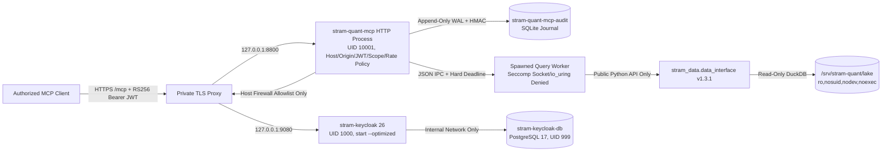

# STRAM HQ Handoff: Stram Quant MCP — SIDDU M6 Private Staging

**Prepared:** 2026-11-01  
**Host:** `SIDDU` (EndeavourOS Linux, kernel 7.2.11-arch1-1, Rootless Podman 6.1.4, Netavark/pasta, cgroup v2)  
**Repository / Branch:** `/home/siddu/Apps/stram/stram_quant_mcp` (`feat/m6-siddu-local-keycloak` over baseline `d19133350dfba394dac94f7e5615def4a366a3cc`)  
**Pinned Data Plane:** `stram-data` `1.3.1` (`890b44911b56d0f165cfa7962032d00292b4e10e`), wheel SHA-256 `330851cec2b5e5a03a09dbbebf3fba2eb4c0d91018e563cbb5773c6af990d699`  
**Stage Status:** Code, Quadlet templates, local Keycloak realm, online WAL audit backup/checkpointing, and HTTPS real-lake acceptance tests **COMPLETE & VERIFIED** (`101/101` tests passing); live service activation on `SIDDU` **BLOCKED ON INTERACTIVE SUDO & TLS/DIGEST INPUTS** (services remain safely stopped and boot-disabled).

---

## 1. Infrastructure

### SIDDU Operating System & Deployment Model
- **OS & Runtime:** EndeavourOS Linux on `SIDDU` using rootless Podman 6.1.4 and systemd user Quadlets (`~/.config/containers/systemd/`).
- **Network Isolation Model:** All container listeners bind strictly to host loopback (`127.0.0.1`). No service binds to `0.0.0.0` on the host or opens a public internet port.
- **Tailscale & Private HTTPS Topology:**
  - Tailnet node: `siddu.tailc5da4c.ts.net` (`100.117.151.7`).
  - Approved private URLs (configured in `/etc/stram-quant/auth.env`):
    - **Quant MCP Resource / Audience (`STRAM_MCP_RESOURCE_URL`):** `https://<approved-private-quant-host>/mcp`
    - **Keycloak Public Issuer (`STRAM_MCP_ISSUER_URL`):** `https://<approved-private-auth-host>/realms/stram-staging`
    - **Keycloak OIDC Discovery:** `https://<approved-private-auth-host>/realms/stram-staging/.well-known/openid-configuration`
    - **Keycloak JWKS (`STRAM_MCP_JWKS_URL`):** `https://<approved-private-auth-host>/realms/stram-staging/protocol/openid-connect/certs`
    - **Keycloak Admin (`KEYCLOAK_ADMIN_URL`):** `https://<approved-private-auth-admin-host>` (blocked on the public reverse proxy).

### Linux Service Accounts & Permissions
| Account | UID / GID | SubUID / SubGID | Linger | Purpose & Boundaries |
|---|---|---|---|---|
| `stram-quant` | `1002:1003` (`/usr/bin/nologin`) | `231072:65536` | Enabled | Runs `stram-quant-mcp`. Read-only access to `/srv/stram-quant/lake`. Owns Podman volume `stram-quant-mcp-audit` and secret `stram-quant-audit-key`. No membership in Data Plane, Docker, Kafka, or PostgreSQL groups. |
| `stram-auth` | Dedicated non-login user (staged) | Dedicated `65536` range | Enabled | Runs `stram-keycloak-db` and `stram-keycloak` on `--internal` Podman network `stram-auth-private`. Zero access to `/srv/stram-quant/lake`, audit volume, or audit HMAC key. |
| `stram-quant-ci` | `1001:1002` | — | Disabled | Self-hosted GitHub runner (`actions.runner.*`); **kept disabled** via `systemctl disable --now` due to public-repository security boundaries. |

### Filesystem Layout, Mounts & Protected Paths
| Path | Owner / Mode | Purpose |
|---|---|---|
| `/home/siddu/Apps/stram/data-lake/parquet` | `siddu:siddu` | Canonical Stock Parquet lake (797+ Parquet files; writable only by Data Plane ingestion). |
| `/srv/stram-quant/lake` | `root:root` (`ro,nosuid,nodev,noexec`) | Systemd bind mount (`srv-stram\x2dquant-lake.mount`) exposing read-only lake view to `stram-quant`. |
| `/etc/stram-quant/auth.env` | `root:root` `0600` | Non-secret Keycloak/MCP URLs, realm, tenant, ports, and immutable `@sha256` image digests. |
| `/etc/stram-quant/m6-approval.env` | `root:root` `0600` | Operator evidence gates (`M6_STAGING_AUTHORIZED`, `APPROVED_IMAGE_REF`, `ROLLBACK_IMAGE_REF`, etc.). |
| `/etc/stram-quant/secrets/` | `root:root` `0700` (files `0400`) | `keycloak-db-password`, `keycloak-bootstrap-password`, `keycloak-smoke-client-secret`, `keycloak-discovery-client-secret`, `checkpoint-signing-key`. |
| `/etc/stram-quant/staging-calls.json` | `root:root` `0600` | Representative Stock lake tool calls (`discovery`, `read`, `lineage`, `analytics`) for `verify`. |
| `/etc/stram-quant/negative-tokens/` | `root:root` `0700` | Temporary realm-signed negative test JWTs (`wrong-issuer.jwt`, `wrong-audience.jwt`, `wrong-tenant.jwt`, `expired.jwt`). |
| `/home/stram-quant/.config/stram-quant-mcp/service.env` | `stram-quant:stram-quant` `0600` | Non-secret MCP runtime configuration (`STRAM_MCP_*`). |
| `/home/stram-quant/.config/containers/systemd/stram-quant-mcp.container` | `stram-quant:stram-quant` `0600` | Rootless Quadlet unit for Quant MCP. |
| `/home/stram-auth/.config/stram-auth/import/stram-staging-realm.json` | `stram-auth:stram-auth` `0600` | Staged Keycloak realm import file. |
| `/home/stram-auth/.config/containers/systemd/stram-keycloak*.container` | `stram-auth:stram-auth` `0600` | Rootless Quadlet units for Keycloak PostgreSQL and Keycloak server. |
| `/var/lib/stram-quant/audit-backups/` | `root:root` `0400` artifacts | WAL-consistent SQLite audit backups (`audit-<UTC>.sqlite3`) and HMAC-signed checkpoints (`audit-<UTC>.checkpoint.json`). |

---

## 2. Services

| Service / Unit | Identity | Container UID/GID | Loopback Port | Network | Image Requirement | Status |
|---|---|---|---|---|---|---|
| `stram-keycloak-db.service` | `stram-auth` | `999:999` (`keep-id`) | None (internal alias `stram-keycloak-db:5432`) | `stram-auth-private` (`--internal`) | `POSTGRES_IMAGE_REF` (`postgres:17.x@sha256:...`) | Staged / Stopped |
| `stram-keycloak.service` | `stram-auth` | `1000:0` (`keep-id:uid=1000,gid=1000`) | `127.0.0.1:9080->8080`, `127.0.0.1:9001->9000` | `stram-auth-private` (`--internal`) | `KEYCLOAK_IMAGE_REF` (`keycloak:26.x@sha256:...`, built via [Containerfile](../deploy/keycloak/Containerfile)) | Staged / Stopped |
| `stram-quant-mcp.service` | `stram-quant` | `10001:10001` (`keep-id:uid=10001,gid=10001`) | `127.0.0.1:8800->8000` | `stram-quant-private` + host egress allowlist | `APPROVED_IMAGE_REF` (`stram-quant-mcp@sha256:...`; local probe image `7ed98c275ce5...`) | Staged / Stopped |

### Existing SIDDU Services (Verified Unchanged)
- `stram-api` (`127.0.0.1:8000`), `stram-ui` (`127.0.0.1:3000`), Stock ingestion, News pipeline, Kafka, and operational PostgreSQL remain completely separate and unmodified.

### Operational Commands
All lifecycle operations use the single idempotent entrypoint [`deploy/stram_quant_siddu.sh`](../deploy/stram_quant_siddu.sh):

```bash
# 1. Read-only inventory
bash deploy/stram_quant_siddu.sh doctor
sudo bash deploy/stram_quant_siddu.sh doctor

# 2. Verify stram-quant mount/volume/secret, run worker & preflight probes, create initial configs
sudo bash deploy/stram_quant_siddu.sh prepare

# 3. Stage stram-auth secrets, internal network, PostgreSQL volume, realm import, and Quadlets
sudo bash deploy/stram_quant_siddu.sh auth-prepare

# 4. Start Keycloak/PostgreSQL and verify local management readiness (:9001/health/ready)
sudo bash deploy/stram_quant_siddu.sh auth-start

# 5. Verify HTTPS OIDC discovery and JWKS from both host and MCP container TLS context
sudo bash deploy/stram_quant_siddu.sh auth-verify

# 6. Validate all M6 approval gates, probe approved digest, and start stram-quant-mcp (:8800/health/ready)
sudo bash deploy/stram_quant_siddu.sh activate

# 7. Run seccomp, DNS/IPv4/IPv6 egress denial, and full HTTPS MCP acceptance suite
sudo bash deploy/stram_quant_siddu.sh verify

# 8. Create WAL-consistent SQLite audit backup, verify chain, and write signed checkpoint
sudo bash deploy/stram_quant_siddu.sh backup-audit

# 9. Rollback to ROLLBACK_IMAGE_REF digest (backs up audit first, probes lake, restarts unit)
sudo bash deploy/stram_quant_siddu.sh rollback

# 10. Check service and readiness status
sudo bash deploy/stram_quant_siddu.sh status
```

---

## 3. Architecture



- **Canonical Data Plane (`stram_data` v1.3.1):** Owns all Parquet schemas, manifests, DuckDB execution, availability modes (`strict`, `estimated`, `ex_post`), revisions, lineage, and financial calculations.
- **Authenticated MCP Tool Plane (`stram_quant_mcp`):** Exposes exactly 10 read-only tools with closed Pydantic schemas (`additionalProperties: false`), per-tool OAuth scope enforcement (`quant:discover`, `quant:read`, `quant:lineage`, `quant:analytics`), single-tenant admission (`tenant_id`), bounded single-worker concurrency, and tamper-evident HMAC audit logging.
- **Local Staging IdP (Keycloak 26):** Runs in production `start --optimized` mode on an `--internal` Podman network under `stram-auth`. Issues 5-minute `RS256` tokens via confidential service accounts (`stram-quant-smoke` and `stram-quant-discovery-only`) with explicit audience (`oidc-audience-mapper`) and tenant (`oidc-hardcoded-claim-mapper`) mappers.

---

## 4. Operations

### Backup, Recovery & Rollback
1. **Audit Backup (`backup-audit`):** Runs `python -m stram_quant_mcp.audit backup` inside a read-only, networkless container using `sqlite3.Connection.backup` (WAL-safe), verifies the entire HMAC hash chain independently against `stram-quant-audit-key`, writes an HMAC-SHA256 signed checkpoint using `/etc/stram-quant/secrets/checkpoint-signing-key`, and locks both files to `root:root` mode `0400`.
2. **Rollback (`rollback`):** Requires `ROLLBACK_IMAGE_REF` (`@sha256:...`) and `ROLLBACK_AUTHORIZED=yes` in `/etc/stram-quant/m6-approval.env`. Executes `backup-audit` first, runs `probe_quant` on the rollback digest against `/srv/stram-quant/lake`, backs up the Quadlet to `stram-quant-mcp.container.pre-rollback`, renders the rollback digest, restarts `stram-quant-mcp.service`, and verifies `/health/ready`. The Stock lake is never modified.
3. **Keycloak Backup:** Perform consistent `pg_dump` backups of `stram-keycloak-db` while Keycloak is quiesced; realm JSON export (`stram-staging-realm.json`) is configuration-transfer evidence only.

### Credential & Key Rotation
- **Audit HMAC Key Rotation:** Stop `stram-quant-mcp`, run `backup-audit`, create a new 32+ byte Podman secret and empty SQLite database, record the old terminal hash and new `key_id` in a signed rotation record, and restart.
- **Keycloak Secrets:** Stored in `/etc/stram-quant/secrets/` (`0400`) and injected via Podman secrets (`stram-keycloak-db-password`, `stram-keycloak-bootstrap-password`, `stram-keycloak-smoke-secret`, `stram-keycloak-discovery-secret`). Never pass secrets on the CLI or commit them to Git.

---

## 5. Release Evidence & M6 Gate Status

### Executed Verification Commands & Results (2026-11-01)
| Command | Result | Evidence Summary |
|---|---|---|
| `uv run --frozen pytest --cov --cov-report=term-missing -q` | `PASS` | **101 passed**, branch coverage **86.08%** (exceeds 85.0% gate). Includes end-to-end HTTPS OIDC/MCP acceptance against both synthetic and canonical Stock lake data. |
| `uv run --frozen mypy` | `PASS` | `Success: no issues found in 17 source files` (strict mode). |
| `uv run --frozen ruff check . && uv run --frozen ruff format --check .` | `PASS` | `All checks passed!`, `60 files already formatted`. |
| `uv run --frozen python -m stram_quant_mcp.tools.export_schema --check` | `PASS` | Zero drift against reviewed `contracts/tool_schemas.json`. |
| `uv run --frozen python tools/check_docs.py` | `PASS` | `links: ok`, `commands: ok`, `secrets: ok`, `examples: ok`, `diagrams: ok` (12 files, 17 examples, 7 Mermaid diagrams). |
| `uv run --frozen python tools/verify_otel_fixture.py` | `PASS` | `canary_redacted: true`, `status: ok`. |
| `uv run --frozen pip-audit --ignore-vuln GHSA-vff6-v3pj-727r --ignore-vuln CVE-2026-25087` | `PASS` | `No known vulnerabilities found, 2 ignored` (documented PyArrow exception in [SECURITY_EXCEPTIONS.md](SECURITY_EXCEPTIONS.md)). |
| `uv run --frozen detect-secrets scan` | `PASS` | Zero secret findings across tracked and untracked files. |
| `bash deploy/stram_quant_siddu.sh doctor` | `PASS` / `NOT VERIFIED` | Ports `8800`, `9080`, `9001` free; `nft` and `firewall-cmd` installed; privileged checks require interactive `sudo`. |

### M6 Staging Gate Checklist
| Gate | Status | Evidence / Remaining Blocker |
|---|---|---|
| Dedicated `stram-quant` rootless identity & read-only `/srv/stram-quant/lake` mount | `VERIFIED` | Confirmed in handoff (`ro,nosuid,nodev,noexec`, UID `1002`, subuid `231072:65536`). |
| Real-lake `preflight`, `worker-network-probe`, and `worker-interface-probe` | `VERIFIED` | Confirmed in handoff (`stram_data_version=1.3.1`, `uid=10001`, seccomp `EPERM` on `socket`/`io_uring`). |
| Consolidated installer (`doctor`, `prepare`, `auth-*`, `activate`, `verify`, `backup-audit`, `rollback`) | `VERIFIED` | Implemented in [`deploy/stram_quant_siddu.sh`](../deploy/stram_quant_siddu.sh) and syntax/unit-tested. |
| End-to-end HTTPS OIDC + MCP acceptance against real Stock lake data | `VERIFIED (In-Process HTTPS)` | `test_staging_acceptance_against_real_stock_lake_readonly` passed all 4 tool classes (`discovery`, `read`, `lineage`, `analytics`), positive/negative JWTs, `Host` (`421`), `Origin` (`403`), and insufficient-scope checks against `/home/siddu/Apps/stram/data-lake/parquet`. |
| Privileged host execution (`stram-auth` creation, firewall rules, Quadlet start) | `BLOCKED (Interactive sudo)` | Host `sudo` requires an interactive password (`sudo: a password is required`) and cannot be executed non-interactively by the agent. |
| `PRIVATE_TLS_AND_HOST_POLICY_VERIFIED` | `BLOCKED (External Input)` | Requires operator to enable Tailscale Serve / reverse proxy with trusted TLS certs for the chosen private hostnames and populate `/etc/stram-quant/auth.env`. |
| `SBOM_PROVENANCE_VULNERABILITY_APPROVED` & `APPROVED_IMAGE_REF` | `BLOCKED (External Input)` | Requires pushing reviewed `@sha256:...` digests for `stram-quant-mcp`, optimized `keycloak:26.x`, and `postgres:17.x` and recording them in `auth.env` and `m6-approval.env`. |
| `FIREWALL_EGRESS_IPV4_IPV6_VERIFIED` | `BLOCKED (Interactive sudo)` | Requires root `nftables`/`firewalld` rule application restricting `stram-quant` outbound traffic to the private issuer/JWKS endpoint. |
