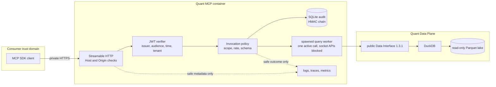
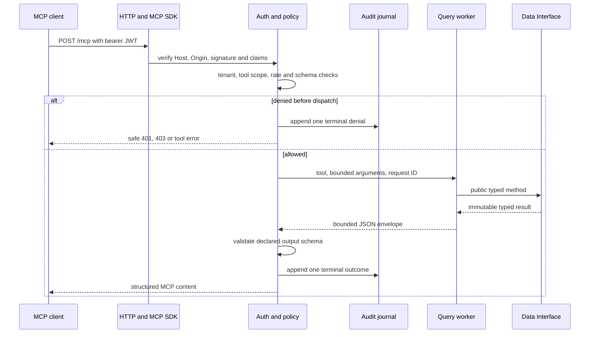
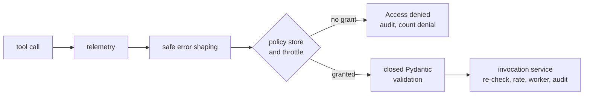
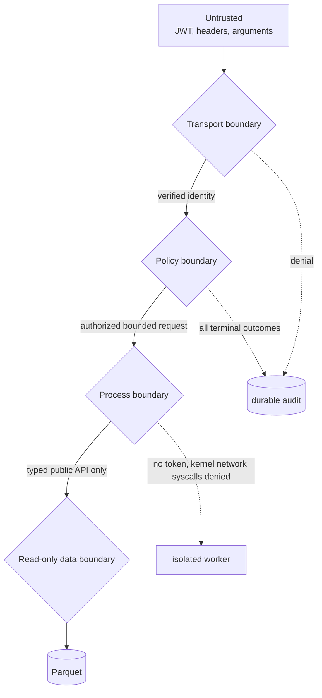
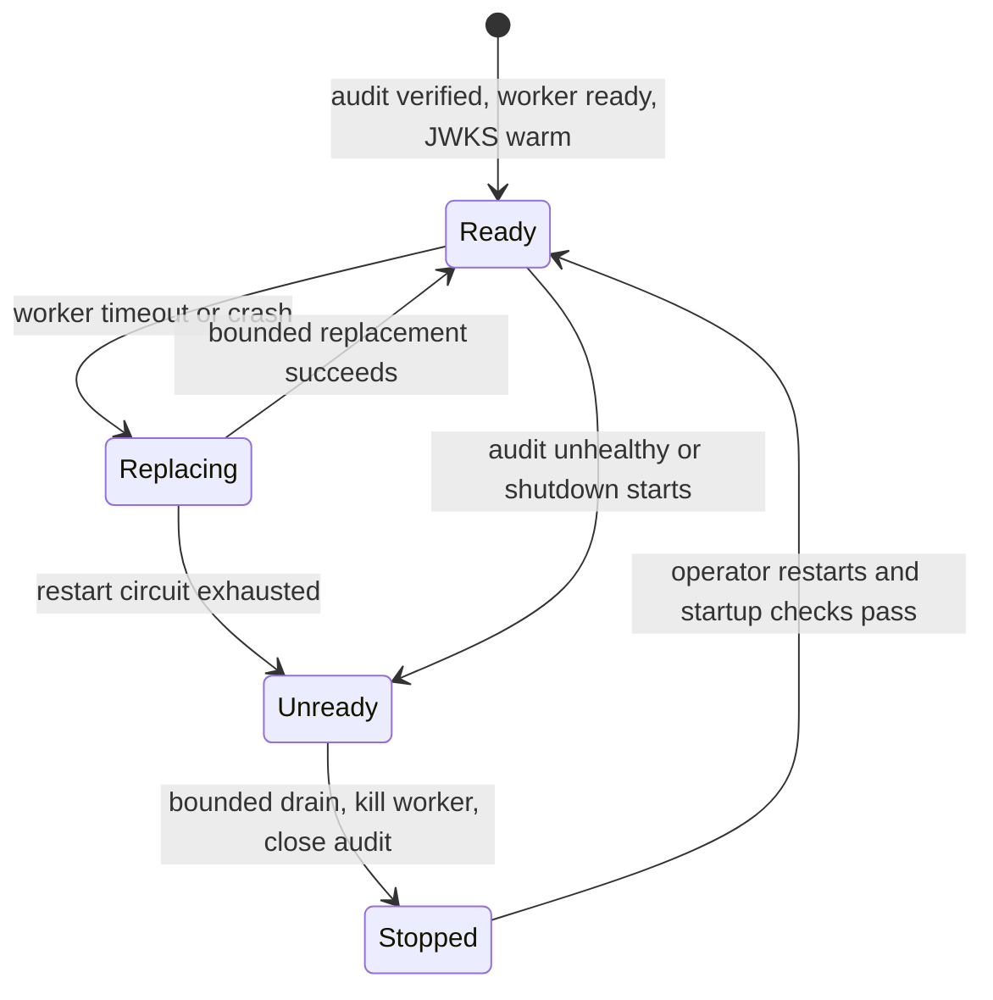

# About the architecture

This service is a thin, independently deployable MCP Tool Plane. It turns authenticated MCP requests
into calls to the frozen public `stram_data.data_interface` 1.3.1 API. Quantitative semantics stay in
the Data Plane; this repository adds no SQL, joins, financial formulas, availability calculations or
write paths.

## Service topology

The HTTP process owns identity and audit. The worker never receives a bearer token, authorization
header or caller claims. On Linux, it installs a fail-closed seccomp filter before importing the Data
Interface: the full socket syscall family and `io_uring` are denied, and Python socket entry points are
also replaced. The container and host network policy separately control the HTTP process. The Data
Interface alone owns DuckDB and lake access.

## Request lifecycle

`src/stram_quant_mcp/tool_registry.py` is the reviewed tool catalog. Pydantic input and output models
are closed and immutable. `QuantToolAdapter` performs only model translation and direct public-method
dispatch. Worker JSON IPC is capped, each tool has a deadline, only one query executes at a time and
the queue is bounded.

Authorization is repeated at dispatch even though authentication happens in HTTP middleware. A call
must carry the configured issuer, tenant and tool-specific scope. Invalid tool names and invalid
arguments never reach the Data Interface. The official MCP annotations are descriptive; server-side
policy is authoritative.

## About per-call access control

The server runs on FastMCP. Three layers of middleware wrap every tool call, outermost first:
telemetry, safe error shaping, and access control. Access control asks one authority, a default-deny
policy store, the same question twice: which tools may this caller see, and may this caller run this
tool now. Because one decision backs both answers, a tool a caller cannot use is never listed and a
direct call to it is refused as `Access denied.`, not reported as missing.

The invocation service repeats the scope, tenant and issuer check after the middleware has passed the
call, so a defect in either layer alone cannot grant access. A caller who is denied too often inside a
sliding window is blocked from every tool until the denials age out; every further attempt extends the
block. Memory for this is bounded, and one caller's denials never affect another caller.

Failures reach the caller only as a fixed message plus a `retryable` flag. The service itself never
retries a data query; the flag tells the client whether trying again could ever help. An access denial
is never retryable. See the [tool reference](../reference/tools.md#error-replies) for the full table.

Token checks are stricter than the framework's own. The verifier behind FastMCP's Keycloak provider
additionally requires `iat`, a subject, a client (`client_id` or `azp`), the admitted tenant and at
least one scope, and it discards the bearer credential after verification. The service refuses to
become ready until the JWKS endpoint has served a signing key.

## Security boundaries

- Transport accepts only configured Host and Origin values and asymmetric JWT algorithms. Production
  URLs require HTTPS. Signature, issuer, audience, expiry, issued-at, optional not-before, subject,
  client, scope and tenant are validated. JWKS is warmed before readiness.
- Policy requires one exact scope per tool and derives tenant only from verified claims. The rate
  limiter and worker admission structures are bounded.
- Audit is a separate SQLite WAL journal using synchronous `FULL`, canonical JSON, monotonic sequence
  numbers and an HMAC link to the previous record. The key is file-mounted separately. The journal is
  tamper-evident, not protection against a host-root attacker; host-owned external checkpoints close
  that gap operationally.
- The runtime image uses UID/GID 10001, a read-only root, dropped capabilities, no-new-privileges,
  bounded tmpfs and a read-only lake bind. Container `serve` runs preflight before opening the server.
- The Linux worker's architecture-checked seccomp policy denies the socket syscall family and
  `io_uring` on reviewed `x86_64` and `aarch64`; unsupported Linux architectures fail worker startup.
  Host egress policy still limits the separate HTTP process to approved identity/telemetry endpoints.
- Logs, traces and metrics use fixed allowlists. They exclude tokens, claims, raw arguments, raw
  results, paths, subjects and unbounded identifiers.

## Failure handling

A timeout or broken worker connection kills the worker before a replacement starts. Replacements have
a configurable cap and delay; repeated infrastructure failures open the circuit and make readiness
false until the service is restarted. A successful worker response clears the consecutive-failure
counter. Cancellation waits for bounded worker cleanup and then writes a terminal `cancelled` audit
outcome. Forced shutdown cannot respawn a worker.

Audit append failure converts the client result to `unavailable`, marks audit unhealthy and makes
readiness false. The service never retries a data query or audit append automatically. Telemetry
export failure is best-effort and does not block a safe read.

## Data semantics

The wrapper preserves Data Interface results without semantic rewriting. `strict` is the default and
uses source vintage or ingestion visibility. `estimated` exposes policy, evidence, uncovered periods
and warnings. `ex_post` is rejected with `as_of` and is always labelled hindsight-only. Exact derived
decimals serialize as strings. Revisions, missing values, quality flags, retractions, lineage IDs,
availability evidence, truncation and caveats remain in the structured response.

The worker startup reports the exact `stram-data` version, interface version and availability-policy
hash. A mismatch fails startup. Schemas and their SHA-256 hashes are checked into
`contracts/tool_schemas.json`.

## Ownership map

| Component | Owns | Must not own |
|---|---|---|
| MCP client/application | User intent and orchestration | Data calculations or direct lake access |
| This repository | MCP transport, identity, policy, audit, isolation, safe serialization | SQL, data ingestion, finance logic, lake repair |
| `stram_data.data_interface` | Queries, availability, revisions, lineage, analytics, bounds | MCP, authentication or orchestration |
| SIDDU operators | Identity, mounts, secrets, networking, image, backup and rollback | Ad hoc Data Plane mutation |

See [Tool reference](../reference/tools.md) for contracts, [Operations](../how-to/operate-the-service.md) for controls and
[ADR 002](../../../stram_data/docs/adr/002-data-plane-and-data-interface-boundaries.md) for the upstream
boundary decision.
