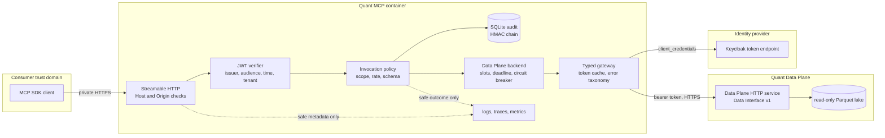
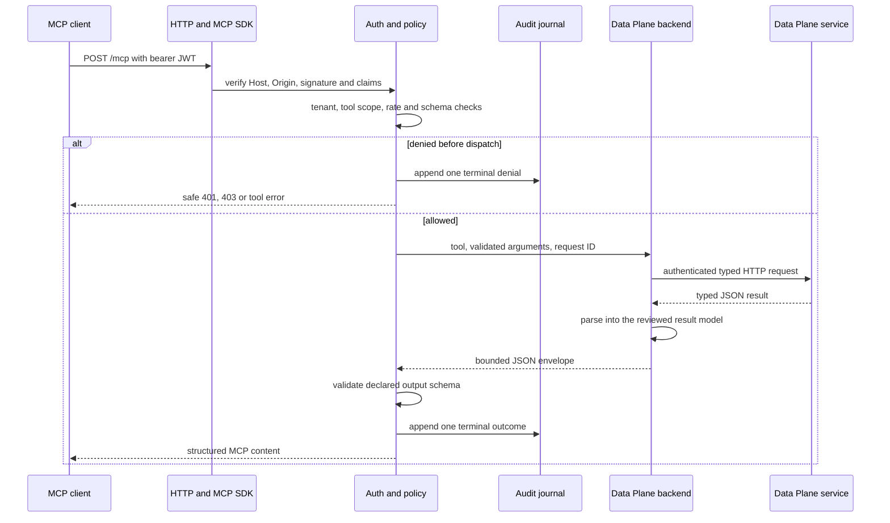
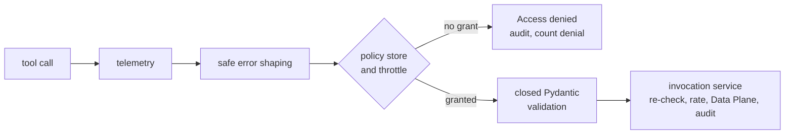
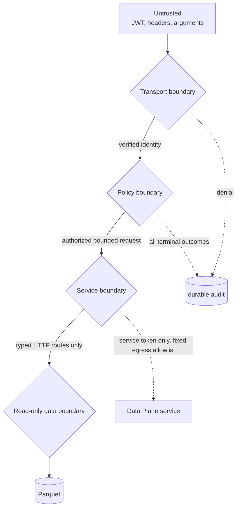
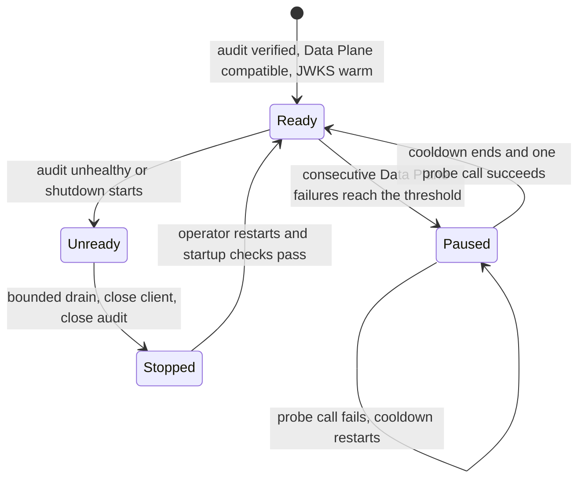

# About the architecture

This service is a thin, independently deployable MCP Tool Plane. It turns authenticated MCP requests
into authenticated HTTP calls to the Stram Data Plane service (1.9 or later, Data Interface v1).
Quantitative semantics stay in the Data Plane; this repository adds no SQL, joins, financial formulas,
availability calculations or write paths, and it holds no lake mount, DuckDB or Parquet access.

## Service topology

The HTTP process owns identity and audit. The Data Plane service owns DuckDB and the lake. This
container holds neither the lake nor a query engine: its only outbound traffic is to the identity
provider's token endpoint, the Data Plane service, and the optional telemetry collector. Host or
container egress policy must allow exactly those destinations and no others.

The service authenticates to the Data Plane with its own `client_credentials` token (the Data Plane
sees this service, not the end user). The end user's identity stays here: scope, tenant and audit are
enforced and recorded before any Data Plane call. Tokens live in memory only, are refreshed about 30
seconds before expiry through a single-flight lock, and are never logged or audited. The client secret
is read from a mounted file, never from the environment or the image.

## Request lifecycle

`src/stram_quant_mcp/tool_registry.py` is the reviewed tool catalog. Pydantic input and output models
are closed and immutable. `QuantToolAdapter` performs only model translation and dispatch to one typed
`DataGateway` method per route. `HttpDataBackend` bounds concurrency (default 4 slots, 2 s queue wait),
enforces each tool's deadline, and opens a circuit breaker after consecutive Data Plane failures.

Validation happens at three points. Input is validated by the closed Pydantic model before anything
else, and a rejection names the offending field and rule without echoing the submitted value. The Data
Plane reply is parsed into the reviewed result model, so contract drift fails as a named
`data_plane_error`. The complete envelope is validated again against the declared output schema before
it is returned.

Authorization is repeated at dispatch even though authentication happens in HTTP middleware. A call
must carry the configured issuer, tenant and tool-specific scope. Invalid tool names and invalid
arguments never reach the Data Plane. The official MCP annotations are descriptive; server-side
policy is authoritative.

## About per-call access control

The server runs on FastMCP. Three layers of middleware wrap every tool call, outermost first:
telemetry, safe error shaping, and access control. Access control asks one authority, a default-deny
policy store, the same question twice: which tools may this caller see, and may this caller run this
tool now. Because one decision backs both answers, a tool a caller cannot use is never listed and a
direct call to it is refused as `Access denied.`, not reported as missing.

The invocation service repeats the scope, tenant and issuer check after the middleware has passed the
call, so a defect in either layer alone cannot grant access. A caller who is denied too often inside a
sliding window is blocked from every tool until the denials age out; every further attempt extends the
block. Memory for this is bounded, and one caller's denials never affect another caller.

Failures reach the caller only as a fixed message plus a `retryable` flag. The service itself never
retries a data query; the flag tells the client whether trying again could ever help. An access denial
is never retryable. See the [tool reference](../reference/tools.md#error-replies) for the full table.

Token checks are stricter than the framework's own. The verifier behind FastMCP's Keycloak provider
additionally requires `iat`, a subject, a client (`client_id` or `azp`), the admitted tenant and at
least one scope, and it discards the bearer credential after verification. The service refuses to
become ready until the JWKS endpoint has served a signing key.

## Security boundaries

- Transport accepts only configured Host and Origin values and asymmetric JWT algorithms. Production
  URLs require HTTPS. Signature, issuer, audience, expiry, issued-at, optional not-before, subject,
  client, scope and tenant are validated. JWKS is warmed before readiness.
- Policy requires one exact scope per tool and derives tenant only from verified claims. The rate
  limiter and backend admission structures are bounded.
- Audit is a separate SQLite WAL journal using synchronous `FULL`, canonical JSON, monotonic sequence
  numbers and an HMAC link to the previous record. The key is file-mounted separately. The journal is
  tamper-evident, not protection against a host-root attacker; host-owned external checkpoints close
  that gap operationally.
- The runtime image uses UID/GID 10001, a read-only root, dropped capabilities, no-new-privileges
  and bounded tmpfs, with no lake mount. Container `serve` runs preflight before opening the server.
- The container reaches only the identity provider's token endpoint, the Data Plane service and the
  optional collector. Host or container egress policy enforces that allowlist; the application never
  follows redirects and ignores proxy environment variables. The Data Plane client secret and service
  token are never logged, audited or placed in a URL.
- Logs, traces and metrics use fixed allowlists. They exclude tokens, claims, raw arguments, raw
  results, paths, subjects and unbounded identifiers.

## Failure handling

Every failure reaches the caller as a classified error that states why it failed, whether retrying can
help and what to do next. The categories separate the caller's mistakes, denied access, this service's
own Data Plane credentials, an unreachable or erroring Data Plane, deadlines and capacity. See the
[tool reference](../reference/tools.md#error-replies) for the full table.

The service never retries a data query on its own. Three narrow, bounded exceptions exist: one token
refresh when the Data Plane returns 401, one reconnect after a connection reset (every route is
read-only and idempotent), and honouring the Data Plane's `Retry-After` value as the caller's wait.
Availability results such as `no_data` or `stale` are normal answers, not errors.

The circuit breaker counts only failures that mean the Data Plane path is unhealthy (outage, deadline,
credential or contract failures). Caller mistakes and `not_found` answers prove the Data Plane is
working and reset the count. While the breaker is open, calls return a retryable `unavailable` error
with the remaining wait instead of queueing behind a failing dependency. Readiness stays true while
the breaker is open, so an upstream outage does not trigger restarts.

Audit append failure converts the client result to `unavailable`, marks audit unhealthy and makes
readiness false. Telemetry export failure is best-effort and does not block a safe read.

## Data semantics

The wrapper preserves Data Interface results without semantic rewriting. `strict` is the default and
uses source vintage or ingestion visibility. `estimated` exposes policy, evidence, uncovered periods
and warnings. `ex_post` is rejected with `as_of` and is always labelled hindsight-only. Exact derived
decimals serialize as strings. Revisions, missing values, quality flags, retractions, lineage IDs,
availability evidence, truncation and caveats remain in the structured response.

At startup the backend reads the Data Plane's public OpenAPI document and requires service version 1.9
or later within major version 1 and Data Interface v1, then hashes the availability policies. A
mismatch fails startup. Responses carry the service version the Data Plane reported. Schemas and their SHA-256 hashes are checked into
`contracts/tool_schemas.json`.

## Ownership map

| Component | Owns | Must not own |
|---|---|---|
| MCP client/application | User intent and orchestration | Data calculations or direct lake access |
| This repository | MCP transport, identity, policy, audit, bounded execution, safe serialization, error taxonomy | SQL, data ingestion, finance logic, lake access or repair |
| Data Plane service (`stram_data` Data Interface v1 over HTTP) | Queries, availability, revisions, lineage, analytics, bounds | MCP, end-user authentication or orchestration |
| SIDDU operators | Identity, mounts, secrets, networking, image, backup and rollback | Ad hoc Data Plane mutation |

See [Tool reference](../reference/tools.md) for contracts, [Operations](../how-to/operate-the-service.md) for controls and
ADR 002 in the sibling `stram_data` repository (`docs/adr/002-data-plane-and-data-interface-boundaries.md`) for the
upstream boundary decision.
