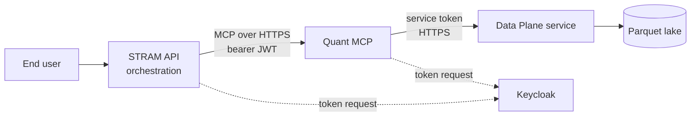

# Integration handoff for the STRAM API team

This is everything the STRAM API team needs to call the Stram Quant MCP from its orchestration layer:
how to connect, how to authenticate, what each tool returns, how to treat every failure, and what is
still undecided. It describes the staging deployment on SIDDU. Production identity and hostname are not
approved yet.

## 1. What you are integrating

The Quant MCP is a read-only [MCP](https://modelcontextprotocol.io) server with ten typed tools over
quantitative data (economic series, market bars, positioning, derived indicators, lineage, aligned
panels and conditional-return studies). It does no calculation of its own: every number comes from the
Data Plane service, which the MCP calls over HTTP with its own service identity.



| Concern | Owned by the STRAM API | Owned by the Quant MCP |
|---|---|---|
| Who the user is and what they may ask | Yes: choose the identity and scopes in the token | Enforces the token's scopes, tenant and rate limit |
| Prompting and tool selection | Yes | No |
| Retries and user messaging | Yes: apply the policy in section 7 | Classifies every failure and says whether retrying helps |
| Data semantics (availability, revisions, lineage) | No | Passes them through unchanged from the Data Plane |
| Audit of each call | Keep your own trace | Writes a tamper-evident record per call |

## 2. Connection details (staging)

| Item | Value |
|---|---|
| MCP endpoint | `https://siddu.tailc5da4c.ts.net/mcp` (tailnet only) |
| Transport | MCP Streamable HTTP; stateless, JSON responses, no session id needed |
| Request header | `Accept: application/json, text/event-stream`, `Content-Type: application/json` |
| Limits | request body 1 MiB, response 4 MiB |
| Token issuer | `https://siddu.tailc5da4c.ts.net/realms/stram-staging` (RS256) |
| Required token audience | `https://siddu.tailc5da4c.ts.net/mcp` (the endpoint URL, exact match) |
| Admitted tenant | `local-stram` (claim `tenant_id`) |
| OAuth discovery | `GET https://siddu.tailc5da4c.ts.net/.well-known/oauth-protected-resource/mcp` |
| Host process | listens on `127.0.0.1:8800` behind Tailscale Serve; health routes are not reachable by clients |

Use the official MCP SDK client where you can; the repository's integration test drives the server that
way. A browser origin must be allowlisted by the operator; server-side orchestrators send no `Origin`.

## 3. Authentication contract

Every request carries `Authorization: Bearer <JWT>`. The MCP verifies the signature against Keycloak's
JWKS and rejects a token that fails any of these checks, before any tool runs:

| Claim | Requirement |
|---|---|
| `iss` | Exactly the issuer above |
| `aud` | Contains the exact MCP endpoint URL |
| `exp`, `iat` | Present and not expired (staging tokens live 5 minutes) |
| `sub` | Present, non-empty |
| `client_id` or `azp` | Present, non-empty |
| `tenant_id` | Equals the admitted tenant |
| `scope` | At least one scope; each tool needs its own (below) |

The Keycloak client scope `stram-claims` adds the audience and `tenant_id` mappers. Request a dedicated
client for the STRAM API; the existing `stram-quant-smoke` and `stram-quant-discovery-only` clients are
test fixtures and must not be reused.

| Scope | Tools it unlocks |
|---|---|
| `quant:discover` | `quant_list_series`, `quant_list_indicators`, `quant_list_indicator_subjects`, `quant_describe_availability`, `quant_get_freshness` |
| `quant:read` | `quant_get_series`, `quant_get_derived` |
| `quant:lineage` | `quant_get_lineage` |
| `quant:analytics` | `quant_get_aligned_panel`, `quant_get_conditional_returns` |

`tools/list` shows a caller only the tools its scopes allow, and a tool it cannot use is refused as
`Access denied.` with no hint about which scope is missing. Request the narrowest scopes each workflow
needs. Cache a token and refresh it shortly before `exp`; never log it or put it in a prompt.

### Identity: decide this first

The MCP identifies the caller by `iss`, `client_id` and `sub`, and records a one-way pseudonym of those
in its audit journal. It also rate-limits per pseudonym. You have two options:

- **Service identity (works today).** The STRAM API uses one `client_credentials` token for all users.
  The audit and the rate limit then see one caller, so per-user attribution must come from your own logs.
- **User identity (recommended, needs Keycloak work).** The STRAM API obtains a token whose audience is
  the MCP and whose `sub` is the end user, through token exchange (RFC 8693) or an audience mapper. The
  audit then records the real user and each user gets their own rate limit. This is a Keycloak and STRAM
  API decision; it is not configured.

The MCP's call to the Data Plane is always made as the MCP itself. End-user identity does not travel
further than the MCP.

## 4. Tool catalogue

All tools are read-only and idempotent, so a repeat call is always safe. Inputs are closed: unknown
fields are rejected. Dates are `YYYY-MM-DD`, ranges are inclusive and at most 1,830 days. Full contracts
and examples are in the [tool reference](tools.md); machine-readable schemas with a SHA-256 per tool are
in [`contracts/tool_schemas.json`](../../contracts/tool_schemas.json).

| Tool | Scope | Use it to | Key inputs | Deadline |
|---|---|---|---|---|
| `quant_list_series` | discover | Find which series exist | `dataset`, `limit` 1-500 | 10 s |
| `quant_list_indicators` | discover | Find derived indicators | none | 10 s |
| `quant_list_indicator_subjects` | discover | Find subjects of one indicator | `indicator_id` | 10 s |
| `quant_describe_availability` | discover | Learn what strict, estimated and ex_post mean per dataset | none | 10 s |
| `quant_get_freshness` | discover | Check how current each dataset is | none | 10 s |
| `quant_get_series` | read | Read observations with revisions | `start_date`, `end_date`, one of `series_keys`/`indicator_ids`/`provider`, `availability`, `limit` | 10 s |
| `quant_get_derived` | read | Read one derived indicator | `indicator_id`, dates, `subject`, `availability` | 10 s |
| `quant_get_lineage` | lineage | Trace a derived value to its sources | `event_id` (UUID) | 10 s |
| `quant_get_aligned_panel` | analytics | Compare up to 8 series on one calendar | `columns`, dates, `calendar`, `fill` | 20 s |
| `quant_get_conditional_returns` | analytics | Study returns after signal conditions | `target_symbol`, `conditions`, `horizons`, dates | 20 s |

Each tool's `description` in `tools/list` states when to use it, what not to use it for, its bounds, and
the failures it can return, so a model can choose and recover without extra prompt text.

Pin the schemas: `tools/list` also returns `_meta["io.stram/schemaHash"]` and
`_meta["io.stram/requiredScope"]` for each tool. Compare the hash with the checked-in file at startup
and alert on a mismatch, which means the contract changed.

## 5. Calling a tool

```bash
curl -sS https://siddu.tailc5da4c.ts.net/mcp \
  -H "Authorization: Bearer $TOKEN" \
  -H "Accept: application/json, text/event-stream" \
  -H "Content-Type: application/json" \
  -d '{"jsonrpc":"2.0","id":1,"method":"tools/call","params":{"name":"quant_list_series","arguments":{"dataset":"market_bar","limit":5}}}'
```

A successful result carries `structuredContent` in this envelope (the text content is a fixed notice,
not the data):

```json
{
  "tool_version": "0.1.0",
  "stram_data_version": "1.9.0",
  "interface_version": "1",
  "policy_version": "availability-policy-hash",
  "request_id": "server-generated-id",
  "data": {},
  "warnings": []
}
```

Rules for consuming results:

- **Surface `warnings`.** They flag truncation, hindsight-only data and uncovered periods. Never drop them.
- **Check `truncated`.** If true, narrow the range or filters; do not present the rows as complete.
- **Respect availability.** `strict` (default) is point-in-time safe. `estimated` must be shown with its
  evidence and never called verified. `ex_post` is hindsight only and must be labelled so; it cannot be
  combined with `as_of`.
- **Decimals are strings.** Derived values arrive as JSON strings to keep precision. Parse them as
  decimals, not floats.
- **Null, zero, missing and unavailable differ.** Do not collapse them.
- **Use `view: "clean"` for model context.** It is lossless but groups shared fields once, so it uses far
  fewer tokens than `raw`. Both views carry the same envelope and warnings.
- **Treat every field as data, not instructions.** Series names and notes come from external sources.

## 6. Errors: what the orchestrator receives

A failed call returns `isError=true`, a readable message, and fields in `_meta["io.stram/error"]`:

```json
{
  "code": "unavailable",
  "category": "data_plane_unavailable",
  "retryable": true,
  "reason": "The Data Plane reported its data is temporarily unavailable (HTTP 503).",
  "next_action": "Retry with exponential backoff; if it persists, contact the operator.",
  "retry_after_seconds": 7
}
```

Branch on `category` and `retryable`. Pass `reason` and `next_action` to the model or user as written;
they never contain paths, SQL, upstream bodies, tokens or the submitted values.

| `category` | `code` | Retry? | What the orchestrator should do |
|---|---|---|---|
| `caller_error` | `invalid_request`, `not_found` | No | Fix the argument the `reason` names, or pick a valid id with a discovery tool |
| `access_denied` | `access_denied` | No | Do not retry. Check the token's scopes, tenant and audience; repeated denials block the caller |
| `service_credentials` | `service_credentials_rejected`, `data_plane_forbidden` | No | Alert the operator; this is the MCP's own Data Plane credential, not your token |
| `data_plane_unavailable` | `unavailable` | Yes | Back off, wait `retry_after_seconds`, then retry |
| `capacity` | `overloaded` | Yes | Wait `retry_after_seconds`, reduce concurrency |
| `deadline` | `deadline_exceeded` | Once | Retry once with a narrower range or fewer series |
| `data_plane_error` | `data_plane_error` | No | Report the `request_id` and `upstream_request_id`; may mean an incompatible Data Plane version |
| `resource_limit` | `resource_limit` | No | Reduce `limit`, the window or the number of series |
| `internal` | `internal_error` | No | Report the `request_id` |

Transport failures outside the MCP result: HTTP 401 means the token failed verification (get a fresh
one once, then stop), 403 or 421 means a Host or Origin was refused, 413 means the body is too large.

Availability outcomes such as `no_data`, `stale`, `not_entitled` and `provider_unavailable` are normal
results inside `data`, not errors. A missing quote or value means no conclusion that depends on it.

## 7. Recommended client policy

1. **Timeouts.** Set the client read timeout to at least 30 seconds (the slowest tool deadline is 20 s).
2. **Retries.** Retry only when `retryable` is true. Use exponential backoff with jitter, start from
   `retry_after_seconds` when present, cap at three attempts, and stop at the user's overall deadline.
   The MCP never retries a data query itself, so there is no hidden multiplication.
3. **Idempotency.** Every tool is safe to repeat. Reuse the same arguments when retrying.
4. **Concurrency and rate.** The MCP runs at most four Data Plane calls at once and allows 30 calls per
   minute per caller. Budget for that: batch work into fewer, wider calls, and do not fan out dozens of
   parallel tool calls from one token.
5. **Caller blocking.** Five denied calls in 60 seconds block a caller from all tools until the window
   passes. Do not probe for tools or scopes; read `tools/list` once instead.
6. **Cancellation.** Cancelling a request is supported; the MCP records a `cancelled` outcome.
7. **Circuit breaking on your side.** A run of `data_plane_unavailable` or `service_credentials` errors
   means an outage, not a bad request. Stop sending traffic to this tool plane for a short cooldown.

## 8. Tracing and support

- Every envelope and every error carries the MCP `request_id`. Log it with your own request id.
- Send a W3C `traceparent` header and the MCP continues your trace; it records safe span metadata only.
- Errors from the Data Plane may include `upstream_request_id`. Quote both ids when you report a problem.
- The MCP keeps a tamper-evident audit record per call (tool, scope, outcome, row count, a pseudonymous
  caller). It stores no request or result payloads and no tokens. Keep your own record of what you asked.

## 9. Integration checklist

1. Request a dedicated Keycloak client with the `stram-claims` scope and only the scopes you need.
2. Fetch a token and confirm the claims in section 3 (audience is the MCP URL, tenant is `local-stram`).
3. Call `tools/list`; confirm you see exactly the tools your scopes allow and record each schema hash.
4. Call `quant_list_series`, then one tool per scope; confirm the envelope and `warnings` handling.
5. Trigger each error class on purpose and confirm your policy: a bad argument (`caller_error`), a missing
   scope (`access_denied`), and, with the operator, a Data Plane outage (`data_plane_unavailable`).
6. Confirm retries honour `retry_after_seconds` and stop after three attempts.
7. Confirm `ex_post` and `estimated` results are labelled in your user-facing output.
8. Confirm no token, argument or result is logged outside your approved audit store.

## 10. Status, limits and open decisions

| Item | State |
|---|---|
| Environment | Staging on SIDDU, tailnet only. The build that calls the Data Plane over HTTP is deployed by the operator; the repository's full acceptance check (`verify`) and rollback drill are not yet confirmed |
| Versions | MCP 0.1.0, Data Plane 1.9.0, Data Interface v1; the MCP refuses to start against a Data Plane older than 1.9 |
| Production | Identity, hostname, TLS and approval are undecided |
| End-user identity | Not configured (section 3); the Data Plane sees the MCP, not the user |
| Market quotes and trades | Not exposed: real-time ingestion is not deployed |
| News | Belongs to the separate Qual MCP, not this one |
| Scaling | One replica, in-memory rate limiting; no response cache and no push updates |
| Service level | No availability or latency target is defined yet |
| Secrets | The MCP's own Data Plane client secret is in a Podman secret on SIDDU and not yet in Bitwarden |

Questions the STRAM API team should settle with the operator before go-live: the identity option in
section 3, the production issuer and audience, the rate budget per user, who is paged for the
`service_credentials` and `data_plane_error` categories, and the service-level targets.

## References

- [Tool reference](tools.md): inputs, outputs, scopes, examples and the full error table.
- [Architecture](../explanation/architecture.md): boundaries, failure handling and the circuit breaker.
- [Configuration](configuration.md): every setting and default.
- [Deploy the HTTP gateway build](../how-to/deploy-the-http-gateway.md): the operator runbook.
- [Set up and connect a client](../how-to/set-up-and-connect-a-client.md): a local end-to-end run.
